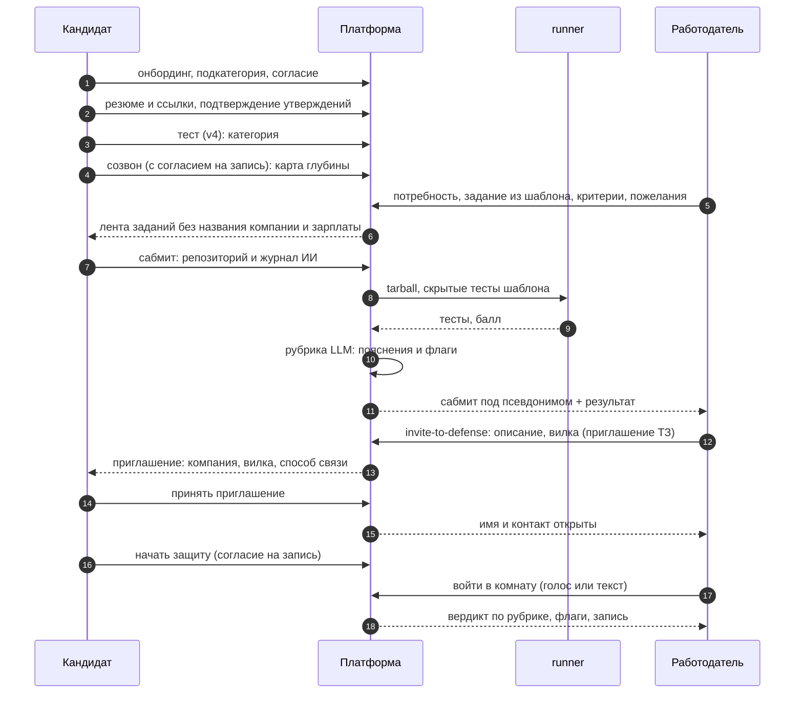

# CJM: пути кандидата и работодателя по трём ступеням

Актуальность: **10 октября 2026 года** (МСК), main `05489a3`. Что видит и делает каждая сторона на каждом шаге и где
работодатель видит кандидата под псевдонимом. Архитектура и границы доверия — [platform.md](platform.md), решение — [ADR 0003](decisions/0003-three-stage-assessment.md),
требования — R-C-16, R-E-07, R-D-01…R-D-03 (контакты и имя закрыты до принятия приглашения).

**Псевдоним** — «Кандидат #XXXXXX» (sha256 от id кандидата): его видит работодатель на всех шагах до **принятого** приглашения
**его компании**. До принятия закрыты имя, контакт, цитаты из резюме, транскрипт и запись созвона. Решает сервер
(`employer/privacy.ts`, `call/access.ts`, `defense-room/access.ts`); чужой объект и скрытый кандидат — 404.

## Сквозной сценарий

## Путь кандидата

| # | Шаг (экран) | Что делает и видит кандидат | Что видит работодатель | Псевдоним |
|---|---|---|---|---|
| 0 | Вход (`/auth`, `/demo`) | Почта с кодом, Яндекс ID или демо-вход | — | — |
| 1 | Онбординг (`/onboarding`) | Согласие на обработку ПДн, роль, чат-опрос: цель, ФСП ID («не участвовал» допустимо), **направление и подкатегория** (обязательны для теста), стек, формат работы, зарплата, контакт | Ничего: профиля в подборке ещё нет | — |
| 2 | Консультант (`/consultant`) | Загружает резюме и ссылки; получает карточки утверждений с цитатами; подтверждает кнопками; профиль по уровням доказанности, пробелы, рекомендации. Уровень ставит код, не модель | Если подтверждено ≥ 1 утверждения и кандидат не скрылся — попадает в подборку и поиск: специализация, утверждения формулировкой каталога с уровнем, отметка ФСП | Да: «Кандидат #XXXXXX» |
| 3 | Тест (`/test`) | Адаптивный тест своей подкатегории: 7–10 заданий (до 13 с дозадаванием); итог «подтверждён / нет», разбор своих заданий; Junior, Middle или Senior (Senior — сверх ТЗ). Не прошёл — предложение грейда ниже в один клик, пересдача по интервалам | Категория «направление × подкатегория × грейд» — фильтр, множитель в балле, строка в объяснении; кандидат с подходящей категорией виден даже без резюме | Да |
| 4 | Квалифицирующий созвон (`/consultant`, «Созвониться») | Отдельное согласие на запись → аватар задаёт 4–6 вопросов по темам профиля, отвечает голосом или текстом; в конце — «карта глубины»: тема → заявлено → копнули → подтвердилось. Подтверждённые темы получают уровень `platform` (категория не меняется) | Публичный вердикт созвона: оценки по темам, без цитат, транскрипта и записи (`GET /api/call/:id`). В карточке подборки показан как карта глубины (employer-card слит) | Да |
| 5 | Лента заданий (`/projects`) | Видит открытые задания своего направления и грейда не выше категории — **без названия компании и зарплаты** («это задача для защиты, не вакансия»); условие в домене работодателя, видимые тесты, срок. Берёт до 3 одновременно, скачивает заготовку | Опубликовал задание к потребности: шаблон (направление × подкатегория × грейд), обязательные критерии из каталога, пожелания текстом | Да, и кандидат компанию не видит |
| 6 | Сабмит (`/projects/:id`) | Указывает публичный репозиторий GitHub и журнал работы с ИИ (ИИ разрешён явно); видит статус проверки и свой результат (число пройденных тестов и рубрика; имена скрытых тестов не показываются) | Сабмит по потребности: результат скрытых тестов (балл), таблица «критерий → прошёл / нет → доказательство», статус, флаги. Ссылка на репозиторий раскрывает логин GitHub, поэтому работодателю она открывается только после принятия приглашения | Да |
| 7 | Приглашение на защиту (`/invitations`) | Получает приглашение: **название компании, описание, вилка зарплаты, способ связи компании** — всё до ответа (R-D-01/02). Принимает или отклоняет; письмо приходит на почту аккаунта | Выбирает сабмит и жмёт «позвать на защиту»: обязательны описание и вилка «от–до». Приглашать можно и без задания, прямо из подборки | До принятия — да |
| 8 | Принятие | «Принять»: имя и контакт кандидата открываются компании; после этого компании доступны транскрипт и запись | Видит имя и контакт, а также запись и транскрипт созвонов | **Снимается** |
| 9 | Защита (`/defense-room/:id`) | Сам начинает защиту (согласие на запись, если ещё не давал): вопросы по своему коду и коммитам (что делает, почему так, что сломается, измени поведение, смени ограничение) плюс вопросы работодателя. Отвечает голосом (WebRTC) или текстом | Комната `/employer/calls/:id`: входит живьём, может перебить, «замьютить ИИ», говорить сам; видит транскрипт вживую. Аудио P2P, TURN нет — при неудаче канал текстовый | Снят (доступ только после `accepted`) |
| 10 | Итог защиты | Видит свой вердикт и запись | Оценки по рубрике A-02 (3 прогона, медиана) и флаги: `strong_project_weak_defense`, `short_defense`, `evaluator_disagreement`, `employer_questions_unanswered`, `no_project_result`. Слабая защита при сильном проекте — флаг, не понижение; вердикта «фейк» нет | Снят |
| 11 | Дозащита | Вопросы работодателя, заданные после защиты, ждут в очереди и задаются при следующем входе | Задаёт вопросы в очередь (до 10, 5–1000 знаков) и читает ответы | Снят |

Кандидат без ФСП проходит тот же путь без штрафа (R-FSP-03). Кандидат может скрыть себя из подборок флагом
`hiddenFromEmployers` (`/invitations`): тогда ему нельзя отправить новое приглашение, а его созвоны и сабмиты чужие компании не видят.

## Путь работодателя

| # | Шаг (экран) | Что делает и видит работодатель | Что получает от ступеней | Псевдоним |
|---|---|---|---|---|
| 0 | Вход и онбординг (`/onboarding`, роль «работодатель») | Согласие, компания, ИНН (контрольная сумма), отрасль, описание, способ связи, первая потребность | — | — |
| 1 | Потребность (`/employer/needs/new`) | Направление, подкатегория, грейд (три), стек, команда, вилка «от–до», требования из каталога с весами | — | — |
| 2 | Подборка (`/employer/needs/:id`) | Ранжированные карточки с объяснением «почему здесь»: закрытые требования с уровнем, категория, ФСП, стек. Фильтры меняют URL, прежние выдачи остаются в истории | Ступень теста: категория. Ступени 1–3 **в балле и карточке пока не участвуют** | Да |
| 3 | Поиск (`/employer/search`) | Та же выдача по всей базе с фильтрами (направление, подкатегория, грейд, стек, только с ФСП, только с категорией) | Категория | Да |
| 4 | Задание к потребности (`POST …/needs/:id/project`) | Выбирает шаблон (спец × подкатегория × грейд, контракт и скрытые тесты фиксированы), обязательные критерии из каталога и пожелания свободным текстом; модель пишет легенду в домене компании и рубрику для пожеланий. Контракт шаблона не меняется — балл сравним между кандидатами | Публикуется в ленте без названия компании и зарплаты | Кандидат — да |
| 5 | Сабмиты (`GET /api/employer/project-submissions`) | Список сабмитов своих потребностей: балл скрытых тестов, рубрика, проверка `platformOwned`-файлов (`modified` / `missing`), журнал ИИ кандидата; ссылка на репозиторий — только после принятия | Ступень 2 | Да |
| 6 | Приглашение на защиту | `invite-to-defense`: то же приглашение, что и прямое (название, описание, вилка), плюс ожидающая защита. Можно отправить и без задания | — | Да, до принятия |
| 7 | Принятое приглашение | Имя, контакт, транскрипт и запись созвонов | Ступени 1 и 3 целиком | **Снят** |
| 8 | Комната защиты (`/employer/calls/:id`) | Вход, перебивание, мьют ИИ, реплики; очередь вопросов кандидату; транскрипт вживую | Ступень 3: вердикт и флаги | Снят |
| 9 | Трекинг (`/employer/invitations`) | `sent → viewed → accepted / declined`; лимит 20 приглашений в сутки на компанию, одно открытое приглашение компании кандидату | — | — |

## Как читать расхождения с ТЗ

- **Лента заданий и R-D-01/02.** Кандидат видит задание без компании и зарплаты — до приглашения. Приглашение, после которого
  открываются контакт и комната, всегда содержит название, описание, вилку и способ связи: это и есть приглашение ТЗ, расхождения нет.
- **Senior** — сверх ТЗ (организаторам достаточно двух грейдов). Подкатегории и четыре направления — шире «двух специализаций достаточно».
- **Ступени 1–3 в подборке** участвуют ограниченно: бонус за проверенный проект под эту потребность и за темы, подтверждённые созвоном; защита в балл не входит, но видна в карточке (карта глубины, проект, флаги). Бонусы не калиброваны.
