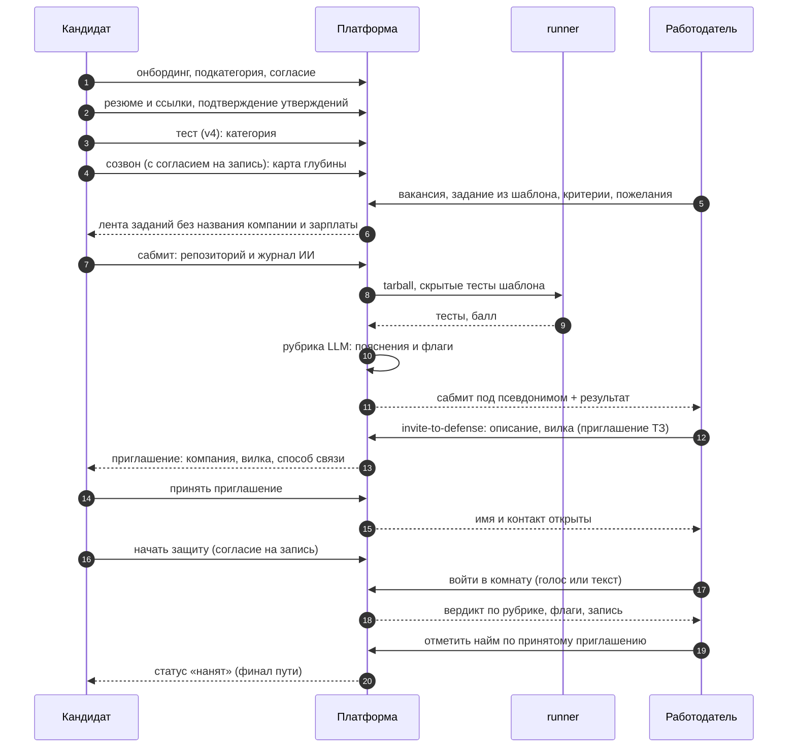

# CJM: пути кандидата и работодателя по трём ступеням

Актуальность: **11 октября 2026 года** (МСК), main `2d31cd8`. Что видит и делает каждая сторона на каждом шаге и где
работодатель видит кандидата под псевдонимом. Архитектура и границы доверия — [platform.md](platform.md), решение — [ADR 0003](decisions/0003-three-stage-assessment.md),
требования — R-C-16, R-E-07, R-D-01…R-D-03 (контакты и имя закрыты до принятия приглашения).

**Метки.** Без метки — есть в main. **«в работе»** — решение владельца, лейн ещё не в main; описано как целевое состояние, по коду main не проверяется. **«не проверено»** — прочитано в коде, но не запускалось.

**Термин.** В интерфейсе — «вакансия»; «потребность» (`Vacancy`, `need`, маршруты `/employer/needs/*`) — только в коде и API (в работе: часть экранов ещё говорит «потребность»).

**Псевдоним** — «Кандидат #XXXXXX» (sha256 от id кандидата): его видит работодатель на всех шагах до **принятого** приглашения
**его компании**. До принятия закрыты имя, контакт, цитаты из резюме, транскрипт и запись созвона. Решает сервер
(`employer/privacy.ts`, `call/access.ts`, `defense-room/access.ts`); чужой объект и скрытый кандидат — 404.

## Целевой путь (решение владельца 11.10, [ADR 0008](decisions/0008-two-defenses-and-live-call-slots.md))

Кандидат: знакомство в чате (ИИ ведёт сам) → тест → квалифицирующий созвон → проект по шаблону компании →
**ИИ-защита проекта** (до приглашения; работодатель видит только вердикт под псевдонимом) → ждёт компанию →
приглашение → **живая защита** с работодателем (назначается слотами, запись обязательна) → найм.

Работодатель: до принятия видит категорию, карту глубины созвона, результат проекта и вердикт ИИ-защиты под
псевдонимом; после `accepted` — имя, контакт, репозиторий, транскрипты и записи; затем предлагает 2–5 слотов
живой защиты, кандидат выбирает один (с согласием на запись), комната открывается за 10 минут до начала.
Что из этого уже в коде, а что в работе — таблица «Что есть в коде» в ADR 0008. Таблицы ниже описывают
текущий код.

## Сквозной сценарий

## Путь кандидата

| # | Шаг (экран) | Что делает и видит кандидат | Что видит работодатель | Псевдоним |
|---|---|---|---|---|
| 0 | Вход (`/auth`, `/demo`) | Три способа: почта + пароль с кодом подтверждения (`api/auth/register`, `verify`, `lib/email-auth.ts`; сброс пароля — `password/forgot`), Яндекс ID (кнопка активна только при `YANDEX_CLIENT_ID/SECRET`), демо-вход (`DEMO_LOGIN=true`). Вход через ФСП ID — `fsp-id` (`mode: login`); без внешних ключей работает мок в процессе (`fspProviderMode() = 'mock'`) | — | — |
| 1 | Онбординг (`/onboarding`) | Согласие на обработку ПДн, роль, чат-опрос: цель, ФСП ID («не участвовал» допустимо), **направление и подкатегория** (обязательны для теста), стек, формат работы, зарплата, контакт | Ничего: профиля в подборке ещё нет | — |
| 2 | Консультант (`/consultant`) | Загружает резюме и ссылки; получает карточки утверждений с цитатами; подтверждает кнопками; профиль по уровням доказанности, пробелы, рекомендации. Уровень ставит код, не модель | Если подтверждено ≥ 1 утверждения и кандидат не скрылся — попадает в подборку и поиск: специализация, утверждения формулировкой каталога с уровнем, отметка ФСП | Да: «Кандидат #XXXXXX» |
| 3 | Тест (`/test`) | Адаптивный тест своей подкатегории: 7–10 заданий (до 13 с дозадаванием); итог «подтверждён / нет», разбор своих заданий; Junior, Middle или Senior (Senior — сверх ТЗ). Не прошёл — предложение грейда ниже в один клик, пересдача по интервалам | Категория «направление × подкатегория × грейд» — фильтр, множитель в балле, строка в объяснении; кандидат с подходящей категорией виден даже без резюме | Да |
| 4 | Квалифицирующий созвон (`/consultant`, «Созвониться») | Отдельное согласие на запись → проверка микрофона и камеры (созвон строго голосом и с видео, без них не начать; текстом — только если запись голоса отозвана в согласиях) → аватар задаёт 4–6 вопросов по темам профиля; в конце — «карта глубины»: тема → заявлено → копнули → подтвердилось. Подтверждённые темы получают уровень `platform` (категория не меняется) | Публичный вердикт созвона: оценки по темам, без цитат, транскрипта и записи (`GET /api/call/:id`). В карточке подборки показан как карта глубины (employer-card слит) | Да |
| 5 | Лента заданий (`/projects`) | Видит открытые задания своего направления и грейда не выше категории — **без названия компании и зарплаты** («это задача для защиты, не вакансия»); условие в домене работодателя, видимые тесты, срок. Берёт до 3 одновременно, скачивает заготовку | Опубликовал задание к потребности: шаблон (направление × подкатегория × грейд), обязательные критерии из каталога, пожелания текстом | Да, и кандидат компанию не видит |
| 6 | Сабмит (`/projects/:id`) | Указывает публичный репозиторий GitHub и журнал работы с ИИ (ИИ разрешён явно); видит статус проверки и свой результат (число пройденных тестов и рубрика; имена скрытых тестов не показываются) | Сабмит по потребности: результат скрытых тестов (балл), таблица «критерий → прошёл / нет → доказательство», статус, флаги. Ссылка на репозиторий раскрывает логин GitHub, поэтому работодателю она открывается только после принятия приглашения | Да |
| 7 | Приглашение на защиту (`/invitations`) | Получает приглашение: **название компании, описание, вилка «от–до» (`salaryFrom`/`salaryTo`), способ связи компании** (`Company.contact`, иначе почта отправителя; пусто — интерфейс пишет, что контакт не указан) — всё до ответа (R-D-01/02). Принимает или отклоняет; письмо приходит на почту аккаунта | Выбирает сабмит и жмёт «позвать на защиту»: обязательны описание и вилка «от–до». Приглашать можно и без задания, прямо из подборки | До принятия — да |
| 8 | Принятие | «Принять»: имя и контакт кандидата (`Candidate.contact`, иначе почта аккаунта, если она не служебная `…@users.invalid`) открываются компании; после этого компании доступны транскрипт и запись | Видит имя и контакт, а также запись и транскрипт созвонов | **Снимается** |
| 9 | Защита (`/defense-room/:id`) | Сам начинает защиту (согласие на запись, если ещё не давал): вопросы по своему коду и коммитам (что делает, почему так, что сломается, измени поведение, смени ограничение) плюс вопросы работодателя. Отвечает голосом (WebRTC) или текстом | Комната `/employer/calls/:id`: входит живьём, может перебить, «замьютить ИИ», говорить сам; видит транскрипт вживую. Аудио P2P, TURN нет — при неудаче канал текстовый | Снят (доступ только после `accepted`) |
| 10 | Итог защиты | Видит свой вердикт и запись | Оценки по рубрике A-02 (3 прогона, медиана) и флаги: `strong_project_weak_defense`, `short_defense`, `evaluator_disagreement`, `employer_questions_unanswered`, `no_project_result`. Слабая защита при сильном проекте — флаг, не понижение; вердикта «фейк» нет | Снят |
| 11 | Дозащита | Вопросы работодателя, заданные после защиты, ждут в очереди и задаются при следующем входе | Задаёт вопросы в очередь (до 10, 5–1000 знаков) и читает ответы | Снят |
| 12 | **Нанят** (`/invitations`) | Приглашение получает статус «нанят» с датой (`hiredAt`): финал пути. Нанят только через принятое приглашение | Отмечает найм кнопкой в трекере (`POST /api/employer/invitations/:id/hire`); из других статусов — 409 | Снят |

### Экраны кандидата вне линейного сценария

Меню (`components/shell/DashboardFrame.tsx`, сейчас): Моя карта, Профиль, Навыки и грейд, ИИнтервью, Проекты, Приглашения, Избранное, Тест на грейд, Консультант, Настройки.
Второй, отдельный список ссылок — `components/shell/nav.ts` (шапка): расхождение двух источников.
**В работе:** меню из одного источника; у кандидата порядок по стадиям — Консультант → Тест → Навыки → Проекты → Приглашения → прочее.

| Экран | Что это |
|---|---|
| `/career` «Моя карта» | Каталог вакансий на карте соответствия (режимы «карта» / «список»): где кандидат закрывает требования, где нет. Кнопка «Откликнуться» — самоотклик как вторичный вход (R-C-12, решение владельца 11.10; `server/employer/applications.ts`), главный вход по-прежнему приглашение работодателя; кнопка «Закрыть пробел» с тремя путями — тест, проект, навык (`lib/career-gap.ts`) |
| `/saved` | «Избранное»: сохранённые вакансии (тот же `CareerPage`, `savedOnly`) |
| `/skills` «Навыки и грейд» | Текущая категория (специализация × грейд), лестница Junior…Senior (Lead недоступен), таблица пробелов «что нужно / сейчас / чем доказать», рекомендации |
| `/interview` | Редирект на `/consultant?call=1`: созвон с ИИ идёт только в окне консультанта (решение владельца 12.10); гейт — только кандидат. Интервью по модели компетенций (`docs/competency-model.md`) — внутри созвона |
| `/settings` | Приватность (скрыть из подборок), способ связи кандидата (`Candidate.contact`), состав анонимной карточки, привязка ФСП ID, аккаунт, согласия |
| `/profile` | Профиль по уровням доказанности, PDF-профиль с сервера (`GET /api/profile/pdf`), история попыток теста и история ответов опроса, уведомление об ограничении выдачи по индексу честности (с путями подтверждения) |

Кандидат без ФСП проходит тот же путь без штрафа (R-FSP-03). Кандидат может скрыть себя из подборок флагом
`hiddenFromEmployers` (`/settings`): тогда ему нельзя отправить новое приглашение, а его созвоны и сабмиты чужие компании не видят.

## Путь работодателя

| # | Шаг (экран) | Что делает и видит работодатель | Что получает от ступеней | Псевдоним |
|---|---|---|---|---|
| 0 | Вход и онбординг (`/onboarding`, роль «работодатель») | Вход теми же тремя способами; согласие, оферта и обязательство по данным (ADR 0005 — без них вместо данных кандидатов форма принятия), компания, ИНН (контрольная сумма), отрасль, описание, способ связи, первая вакансия | — | — |
| 1 | Вакансия (`/employer/vacancies`, создание `/employer/needs/new`, правка `…/needs/:id/edit`) | Каталог своих вакансий; направление, подкатегория, грейд (три), стек, команда, вилка «от–до», требования из каталога с весами | — | — |
| 2 | Подборка (`/employer`, `/employer/needs/:id`) | Ранжированные карточки с объяснением «почему здесь»: закрытые требования с уровнем, категория, ФСП, стек. Фильтры меняют URL, прежние выдачи остаются в истории. В подборку входит кандидат, закрывший ≥ 1 требование **или** с категорией теста этой специализации не ниже требуемого грейда (`dropUncovered`) — утверждения не обязательны | Ступень теста: категория (может не учитываться, пока высокий индекс «честности» не подтверждён тестом или созвоном — не проверено в деталях). Ступени 1–3 в балле ограниченно, см. ниже | Да |
| 3 | Поиск (`/employer/search`) | Та же выдача по всей базе с фильтрами; сохраняет кандидатов в избранное (направление, подкатегория, грейд, стек, только с ФСП, только с категорией) | Категория | Да |
| 4 | Задание к потребности (`POST …/needs/:id/project`) | Выбирает шаблон (спец × подкатегория × грейд, контракт и скрытые тесты фиксированы), обязательные критерии из каталога и пожелания свободным текстом; модель пишет легенду в домене компании и рубрику для пожеланий. Контракт шаблона не меняется — балл сравним между кандидатами | Публикуется в ленте без названия компании и зарплаты | Кандидат — да |
| 5 | Сабмиты (`GET /api/employer/project-submissions`) | Список сабмитов своих потребностей: балл скрытых тестов, рубрика, проверка `platformOwned`-файлов (`modified` / `missing`), журнал ИИ кандидата; ссылка на репозиторий — только после принятия | Ступень 2 | Да |
| 6 | Приглашение на защиту | `invite-to-defense`: то же приглашение, что и прямое (название, описание, вилка), плюс ожидающая защита. Можно отправить и без задания | — | Да, до принятия |
| 7 | Принятое приглашение | Имя, контакт, транскрипт и запись созвонов | Ступени 1 и 3 целиком | **Снят** |
| 8 | Комната защиты (`/employer/calls/:id`) | Вход, перебивание, мьют ИИ, реплики; очередь вопросов кандидату; транскрипт вживую | Ступень 3: вердикт и флаги | Снят |
| 9 | Трекинг (`/employer/invitations`) | `sent → viewed → accepted / declined`; лимит 20 приглашений в сутки на компанию, одно открытое приглашение компании кандидату | — | — |
| 10 | **Нанят** (`/employer/invitations`) | Кнопка отметки найма на принятом приглашении (`accepted → hired`, идемпотентно, при другом статусе 409; уходит событие в ATS-вебхук). Имя и контакт остаются открытыми. Кандидат, нанятый **другой** компанией, исчезает из подборки и поиска этой компании; у нанявшей остаётся | — | Снят |

### ИИ-помощница на каждом экране (Кира) - **в работе 11.10 вечер, не в main**

Плавающая панель-чат (`AssistantDrawer`: кнопка-портрет открывает боковую панель) на экранах подборки и вакансии. Чат знает, где работодатель (`page {path, vacancyId}`), и предлагает быстрые вопросы по странице. Что делает по шагам пути, все действия подтверждает человек кнопкой:

| Шаги | Что делает чат | Черновик / событие | Что подтверждает человек |
|---|---|---|---|
| 0 Онбординг, компания | Дополняет профиль компании по описанию | `company_draft` («было -> станет») | «Применить» -> `PATCH /api/employer/company` |
| 1 Вакансия | Собирает потребность из разговора | `need_draft` (в main) | Форма потребности с предзаполнением |
| 2-3 Подборка, поиск | Подбирает под вакансию, ищет по базе, объясняет кандидата | `candidates` (в main) | Выбор кандидата; контакты не показываются до принятия (R-E-07) |
| 4 Задание | Предлагает шаблон, критерии и пожелания | `project_task_draft` | «Сформировать» -> `POST /api/employer/needs/:id/project` |
| 6 Приглашение | Пишет текст и вилку, сообщает о блокировках (лимит, нет контакта компании) | `invitation_draft` (в main) | Отправка приглашения |

Шаги 5, 7-10 (сабмиты, принятие, защита, трекинг, найм) чат не покрывает: инструментов по ним нет. Страница `/employer/assistant` по-прежнему редиректит на `/consultant`.

### Экраны работодателя вне линейного сценария

Меню (`DashboardFrame.tsx`, сейчас): Подборка, Поиск по базе, Избранное, Вакансии, Приглашения, Собеседования (`/employer/calls`), ИИ-помощник (`/consultant`), Компания; кнопка «+ Новая вакансия». Отдельный список в `nav.ts` (шапка) расходится с ним. **В работе:** меню из одного источника.

| Экран | Что это |
|---|---|
| `/employer/vacancies` | Каталог вакансий компании, создание, архив |
| `/employer/saved` | Избранные кандидаты (хранится в аккаунте работодателя, кандидат не узнаёт); показ — после принятия оферты |
| `/employer/company` | Профиль компании + предпросмотр «Так видит кандидат» (приглашение с вилкой и контактом); согласия и удаление аккаунта |
| `/employer/assistant` | Только редирект на `/consultant`: дом работодателя — лента консультанта (помощник по подбору), решение владельца 10.10 |

## Демо-персоны и стадии пути

**В работе** (`lane/demo-personas`, не закоммичено, не в main): окно входа показывает курированный набор демо-аккаунтов по стадиям пути вместо общего списка; `/demo` описывает возможности и даёт быстрые входы. Источник списка — `server/demo/personas.ts`; данные под каждую персону засеваются реальными записями (`prisma/seed/demo-personas.ts`). Остальные демо-кандидаты (`demo-pool-*`, `demo-ai-*`, `demo-cat-*`) остаются базой поиска и валидации, в окно входа не попадают.

| Персона (id) | Стадия пути | Что видно |
|---|---|---|
| Новый пользователь (`fresh`) | 1. Пусто | Чистый аккаунт, ИИ-помощник начинает знакомство |
| Павел Нестеров (`demo-intro`) | 2. Знакомство | Ответы на середине, вопросы продолжаются в чате |
| Юлия Власова (`demo-frontend-mid`) | 3. Профиль из резюме | 7 утверждений ждут подтверждения, доступен созвон |
| Ксения Андреева (`demo-tested`) | 4. Тест пройден | Frontend · Junior, открыто ИИнтервью, карточка видна компаниям |
| Леонид Исаев (`demo-strong`) | 5. Сильный, с ФСП | Frontend · Middle, достижения ФСП, созвон пройден |
| Марина Котова (`demo-invited`) | 6. Есть приглашение | «Гранит Софт», вилка и контакт видны до ответа |
| Роман Зайцев (`demo-accepted`) | 7. Принял приглашение | Контакты открыты в обе стороны |
| Алёна Мироненко (`demo-hired`) | 8. Нанят | Финал пути (статус `hired`) |
| Анна Кравец · Северный Поток (`demo-employer`) | работодатель: поиск | Вакансии и подборка, приглашений нет |
| Олег Ермаков · Гранит Софт (`demo-employer-granit`) | работодатель: приглашения и найм | Приглашены трое: ждёт ответа, получил контакты, отметил найм |
| Матвей Лисицын (`demo-injection`) | не этап пути | Резюме со скрытой инструкцией: разбор её игнорирует |

Что на текущем main (до лейна): `/demo` и окно входа показывают прежний общий список демо-кандидатов и работодателей; персоны `demo-intro`, `demo-invited`, `demo-accepted`, `demo-hired` и `demo-employer-granit` в main отсутствуют (поиск по `prisma/` и `src/`: упоминаний нет).

## Как читать расхождения с ТЗ

- **Лента заданий и R-D-01/02.** Кандидат видит задание без компании и зарплаты — до приглашения. Приглашение, после которого
  открываются контакт и комната, всегда содержит название, описание, вилку и способ связи: это и есть приглашение ТЗ, расхождения нет.
- **Senior** — сверх ТЗ (организаторам достаточно двух грейдов). Подкатегории и четыре направления — шире «двух специализаций достаточно».
- **Ступени 1–3 в подборке** участвуют ограниченно: бонус за проверенный проект под эту потребность и за темы, подтверждённые созвоном; защита в балл не входит, но видна в карточке (карта глубины, проект, флаги). Бонусы не калиброваны.
- **Зарплатные ожидания кандидата** (`salaryMin`/`salaryExpected`) в подборке и ранжировании не участвуют: в `server/employer/*` на них ссылок нет (проверено поиском по коду). Онбординг теперь не обещает их показ компаниям.
- **Без утверждений.** Кандидат с категорией теста, совпавшей по специализации и не ниже грейда вакансии, виден в подборке под вакансию и без подтверждённых утверждений; ниже требуемого грейда — только при ≥ 1 закрытом требовании. Прочитано в `ranking.ts` (`dropUncovered`, `categoryMatch`) и `matching.ts` (`loadPool`); тестом не прогонялось. При высоком индексе «честности» без подтверждения категория из теста не учитывается (`drop_category`), кандидат об этом уведомлён. **С 11.10 вечера:** основной режим подборки и поиска — только кандидаты с категорией из теста; без категории кандидат попадает в выдачу только при явном расширении пула (`pool=all`) и помечен в объяснении.
- **Самоотклик** кандидата на вакансию есть как дополнение к обратной механике (R-C-12 / R-E-06): «Откликнуться» на «Моей карте», работодатель отвечает в блоке «Отклики» своей потребности, кандидат видит статусы в «Моих откликах» на `/invitations`; контакты открываются только после принятия и согласия. Главный вход остаётся приглашением работодателя — так и говорить.
