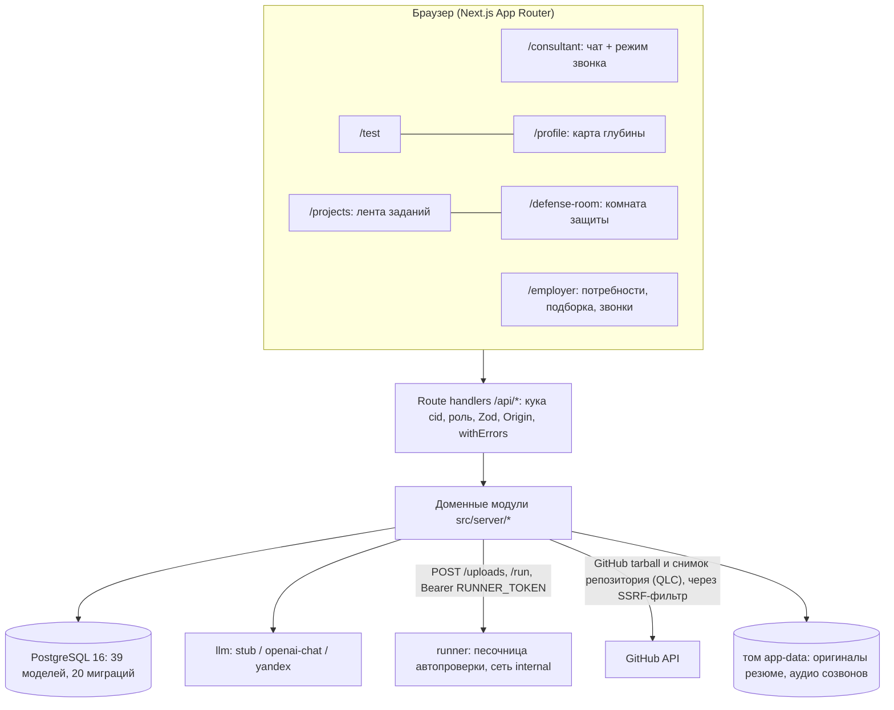

# Платформа: что реализовано

Актуальность: **10 октября 2026 года** (МСК). Код — каталог [`platform/`](../platform), запуск — [platform/README.md](../platform/README.md). Здесь описано то, что есть в коде; решения и план — в [ADR 0003](decisions/0003-three-stage-assessment.md) и [ТЗ консультанта](career-consultant.md), стек — в [stack.md](stack.md). Модули по одному (модели, маршруты, env, ограничения) — [modules.md](modules.md), пути кандидата и работодателя — [cjm.md](cjm.md). Цифры проверки — [validation-results.md](validation-results.md), сценарий показа — [demo-script.md](demo-script.md).

Платформа ведёт кандидата по **трём ступеням оценки** (ADR 0003), а работодателю отдаёт результат одной карточкой:

1. **Тест на грейд** — категория «направление × подкатегория × грейд» ([ADR 0002](decisions/0002-grade-test.md)). Категорию задаёт только он.
2. **Квалифицирующий созвон** с ИИ — «карта глубины» по темам профиля (ступень 1).
3. **Проект под работодателя** из ленты обезличенных заданий: сабмит → автопроверка в песочнице → рубрика (ступень 2).
4. **Защита проекта** в комнате (голос WebRTC или текст) с ИИ-интервьюером и, если захочет, работодателем (ступень 3).

Дополнительно остались **путь с карьерным консультантом** (резюме и ссылки → утверждения с цитатами → подтверждение кандидатом → профиль по уровням доказанности → рекомендации → защита утверждения), **кабинет работодателя** (потребности, подборка, поиск, приглашения с вилкой зарплаты, ассистент) и вход по почте. Что на заглушках — в разделе «Что на заглушках и что не сделано».

## Принцип

Модель читает, спрашивает и предлагает, **код проверяет и решает**. Утверждение попадает в профиль только если оно из закрытого каталога, имеет дословную цитату в источнике, уровень доказанности поставлен кодом по типу источника и кандидат нажал «да». У модели нет инструмента записи в профиль. Грейд считает IRT-движок без LLM; балл проекта — скрытые тесты; оценщики созвона и защиты ставят баллы по рубрике, но порог и уровень доказанности — код. Автоматического вердикта «фейк» нет (ст. 16 152-ФЗ): слабая защита при сильном проекте — флаг работодателю, не понижение.

## Архитектура



Аудио комнаты защиты идёт напрямую между браузерами кандидата и работодателя (WebRTC P2P, публичный STUN, TURN нет); сервер только передаёт сигналинг.

Состав слоёв внутри приложения:

```text
 agent    цикл хода консультанта, 18 инструментов, конвейер первого хода, план В
   ├─ collector  файлы и URL → ExtractedDoc (строки с координатами)
   ├─ claims     каталог (120 записей) → извлекатель (LLM, JSON) → проверяющий (код)
   ├─ recommend  тест, пробелы, задания, вакансии (чистый код)
   └─ defense    защита утверждения: интервьюер и оценщик (LLM), порог и уровень — код
 test     адаптивный тест на грейд (IRT 2PL, генераторы, политика adr-0002-v4)      ← без LLM
 call     ступень 1: квалифицирующий созвон, запись, SSE-шина
 project  ступень 2: шаблоны, лента заданий, сдача, отчёт, приглашение на защиту
 runner   песочница автопроверки (отдельный контейнер)
 defense-room  ступень 3: защита проекта, QLC по коду, комната работодателя, WebRTC-сигналинг
 employer подбор и приглашения, приватность                                         ← без LLM
 llm      адаптер: семафор, таймаут, ретраи, журнал, провайдеры
```

Поток первого хода консультанта с вложениями (`agent/pipeline.ts`) — детерминированный конвейер, а не решение модели:

1. Сборщик читает загрузки и ссылки (GitHub и Codeforces — через профильные клиенты, остальное — через `fetchUrl` с SSRF-фильтрами). Контакты маскируются, скрытый текст помечается.
2. Извлекатель (LLM, строгий JSON по схеме) предлагает «каталожный id + номер строки + цитата + уверенность».
3. Проверяющий (код) отбрасывает всё, что не из каталога, без цитаты в источнике, из скрытых строк, дубликаты.
4. Уцелевшее записывается как черновики (`status = proposed`), в чат уходят события `step` и `claims`. Модель получает только сводку и пишет короткий комментарий.

Дальше кандидат подтверждает карточки кнопками (`/api/claims/:id/confirm|edit|reject`), а консультант отвечает на свободные вопросы циклом с инструментами (не более 6 вызовов за ход).

## Три ступени оценки: сквозной поток

```mermaid
flowchart LR
  A["Онбординг: роль, согласие, подкатегория"] --> B["Тест v4: Junior / Middle / Senior"]
  B -->|"CandidateCategory"| C["Созвон (ступень 1): карта глубины"]
  C --> D["Лента заданий: обезличенные, до 3 активных"]
  D --> E["Сабмит: GitHub-репозиторий + журнал ИИ"]
  E --> F["runner: скрытые тесты шаблона"]
  F --> G["Рубрика LLM: пояснения и флаги, не балл"]
  G --> H["Работодатель видит сабмиты под псевдонимом"]
  H -->|"invite-to-defense = приглашение ТЗ: название, вилка"| I["Кандидат принимает приглашение"]
  I --> J["Комната защиты (ступень 3): ИИ + работодатель, WebRTC или текст"]
  J --> K["Работодатель: результаты проекта и защиты, флаги; единая карточка подборки со ступенями"]
```



1. **Онбординг** (`/onboarding`): согласие на обработку ПДн, роль, опрос в чате; кандидат выбирает подкатегорию — без неё тест не стартует.
2. **Тест** (`/test`): пул — семейства подкатегории (банк 6 Junior + 4 Middle + 4 Senior), заявка Senior идёт по Senior-пулу с дозадаванием Middle. Итог — `CandidateCategory` и подъём подтверждённых утверждений до уровня `platform`.
3. **Созвон** (`/consultant`, кнопка «Созвониться»): ИИ задаёт 4–6 вопросов по темам профиля, маршрут по уровню; слепой оценщик по рубрике A-02 (3 прогона, медиана) ставит оценки. Результат — карта глубины в профиле кандидата (`DepthMap`); работодателю она доступна как публичный вердикт без цитат (в карточку подборки пока не вынесена, см. п. 9); категорию созвон не меняет. Тема, подтверждённая созвоном, получает уровень `platform`. Перед первым звонком — отдельное согласие на запись.
4. **Лента заданий** (`/projects`): работодатель публикует задание к потребности (шаблон + обязательные критерии из каталога + пожелания; условие и рубрику пишет модель, контракт шаблона остаётся неизменным). Кандидат своей категории видит задание **без названия компании и зарплаты**, берёт не больше трёх активных (`PROJECT_MAX_ACTIVE`), скачивает заготовку (`skeleton.zip`).
5. **Сабмит**: ссылка на публичный репозиторий GitHub и журнал работы с ИИ (ИИ разрешён явно). Приложение скачивает tarball коммита (SSRF-фильтр, ≤ 50 МБ) и передаёт его в runner.
6. **runner** запускает скрытые тесты шаблона и возвращает `tests: [{name, passed, ms}]`; балл — доля пройденных, воспроизводим. **Рубрика** (LLM, `project_rubric`) по критериям работодателя даёт пояснение и флаги по каждому критерию, не балл. Статанализ в контракте runner пока не выдаётся: в отчёте он помечен «не выполнялся».
7. **Работодатель** видит сабмиты по своей потребности под псевдонимом «Кандидат #XXXXXX» (ссылка на репозиторий — только после принятия приглашения: она раскрывает логин GitHub) и выбирает, кого позвать. `invite-to-defense` создаёт обычное приглашение (название компании, описание, вилка — R-D-01/02) и ожидающую защиту. Так лента не расходится с ТЗ: приглашение на защиту и есть приглашение ТЗ. Приглашать можно и без задания.
8. **Защита** (`/defense-room`): кандидат сам начинает её, дав согласие на запись. План вопросов строится по коду репозитория и последним коммитам (QLC: «что», «почему», «что сломается», «измени поведение», «смени ограничение»), плюс очередь вопросов работодателя. Работодатель может войти живьём, перебить, «замьютить ИИ» и говорить сам — аудио WebRTC P2P, текст как запасной канал. Вопросы работодателя после защиты копятся и задаются при следующем входе. Оценщик — по рубрике A-02, 3 прогона, медиана; флаги: `strong_project_weak_defense`, `short_defense`, `evaluator_disagreement`, `employer_questions_unanswered`, `no_project_result`.
9. **Что видит работодатель.** Сабмиты своей потребности с результатом автопроверки (под псевдонимом), список защит `/employer/calls`, комнату и транскрипт — после принятия приглашения; публичный вердикт созвона (оценки по темам без цитат) отдаёт `GET /api/call/:id`. **Карточка подборки** показывает карту глубины, результат проекта и флаги защиты (слито, ae1eee2: `CandidateEvidence.calls/projects`, бонусы `PROJECT_BONUS_PER_SCORE` и `CALL_TOPIC_BONUS` в `scoreCandidate`, блоки в `CandidateCard`); защита в балл не входит.

### Границы доверия в трёх ступенях

| Граница | Что держит | Где |
| --- | --- | --- |
| Код кандидата | Исполняется только в runner: контейнер без интернета (`runner-net` `internal`, `gateway_mode isolated`), без `docker.sock`, ФС только на чтение, tmpfs `/work` без `exec`, лимиты 1,5 ГБ / 0,8 CPU / 512 процессов; сервис не от root, задание — отдельный uid 2000, `NoNewPrivs`; в окружении runner только `RUNNER_TOKEN`. Тесты платформы копируются поверх репозитория, конфиги кандидата не читаются | `platform/runner/README.md` |
| Балл runner — сигнал, не доказательство | Код кандидата живёт в одном процессе с vitest/pytest и теоретически может подделать результат. Страхуют: рубрика LLM, защита проекта (QLC по его коду), `logTail` кандидату не показывается | там же |
| Скрытые тесты | Не выдаются кандидату, меняются только новым шаблоном с новым id; файлы `platformOwned` сверяются хешем с заготовкой | `project/templates.ts` |
| Репозиторий и журнал ИИ — данные | В модель идут внутри тегов как недоверенные данные; ссылка модели на несуществующий файл помечается флагом | `project/review.ts`, `defense-room/qlc.ts` |
| Псевдонимизация | До **принятого** приглашения этой компании работодатель видит «Кандидат #XXXXXX», категорию, оценки по темам; имя, контакт, цитаты, транскрипт и запись закрыты. Чужой объект и скрытый кандидат — 404. Решает сервер | `employer/privacy.ts`, `call/access.ts`, `defense-room/access.ts` |
| Запись и согласие | Отдельный пункт согласия перед первым звонком (версия текста в `Consent`); транскрипт — в БД, аудио кандидата — файлы в `CALL_DATA_DIR` (WAV, том `app-data`); кандидат слышит запись всегда, работодатель — только после `accepted`. Живые реплики работодателя оценщику не отдаются | `call/consent.ts`, `call/audio.ts` |
| Авторешения | Нет вердикта «фейк»; слабая защита — флаг; оценка идёт слепым оценщиком, который не видит резюме и результата тестов | `defense-room/verdict.ts` |
| Сигналинг WebRTC | Только пары «кандидат ↔ подключённый работодатель», SDP ≤ 20 000 знаков; медиа P2P через публичный STUN, **TURN нет** | `defense-room/signal.ts` |

## Модули и границы

Каждый модуль, его модели, маршруты, переменные окружения и ограничения («чего не делает») — в [modules.md](modules.md). Здесь только правила, которые пронизывают несколько модулей.

### Уровни доказанности

Уровень ставит код по типу источника (`claims/levels.ts`), модель и кандидат его не меняют:

| Источник | Максимальный уровень |
| --- | --- |
| резюме, документ, чат | со слов (`self_reported`) |
| GitHub, произвольный URL, Stack Overflow | артефакт (`artifact`) |
| Codeforces, ФСП | третья сторона (`third_party`) — только при подтверждённом владении аккаунтом, иначе артефакт |
| защита утверждения, тема, подтверждённая созвоном, решённое задание теста | платформа (`platform`) — только через существующий путь `claim.updateMany` |

Защита, квалифицирующий созвон и тест на грейд поднимают до `platform` и `third_party` (решение 09.10, `PLATFORM_UPGRADABLE`). Порядок уровней — `self_reported < artifact < third_party < platform` (решение 09.10, единый источник `LEVEL_ORDER` в `claims/levels.ts`; веса, дедупликация и сортировки выводятся из него). Вес уровня в покрытии (предложение, не калибровано): со слов 0,25; артефакт 0,5; третья сторона 0,75; платформа 1. Смежное утверждение каталога засчитывается вдвое слабее.

### Рекомендации

Все функции `server/recommend` детерминированы и считаются **только по подтверждённым** утверждениям (кроме рекомендации теста, см. ниже).

| Функция | Правило |
| --- | --- |
| Тест | Сигнатура Middle — записи каталога с весом Middle ≥ 2 и больше веса Junior. Покрытие ≥ 0,25 — предлагаем Middle; 0,15–0,25 — Junior, «Middle, если уверены»; ниже — Junior. Порог 0,25 — решение владельца 09.10 по research/13 (было 0,6, затем 0,4), подобран на gold eval, не на выходе извлекателя; на 30 размеченных профилях: Middle распознан 9 из 13 (при 0,4 — 1 из 13), ложных Middle среди 17 Junior 0. Уже подтверждённый Middle не понижается. Смена грейда не чаще раза в 30 дней. Выбор остаётся за кандидатом |
| Пробелы | Для цели (`vacancy:<id>` или `category:<spec>:<grade>`) приоритет = вес × (1 − зачёт) × посильность; посильность 0,5, если грейд записи выше доказанного больше чем на один |
| Задания | Только из таблицы `Task`: больше закрытых пробелов, затем ближе к доказанному грейду + 1 |
| Вакансии | Обратный прогон матчера по всем вакансиям платформы; текст «закрываешь k из n, не хватает …»; формулировка «по вакансиям на платформе» |

Все пороги и веса — предложения без калибровки на данных (помечены в `recommend/weights.ts`).

## Модель данных

Схема — `platform/prisma/schema.prisma`: 39 моделей, 20 миграций (секции помечены `// lane: <модуль>`, разбивка по модулям — [modules.md](modules.md)).

| Сущность | Что хранит |
| --- | --- |
| `Candidate` | email, имя, специализация, подкатегория (`subcategoryId`, обязательна для старта теста), состояние ФСП (`not_linked`, `no_achievements`, `unavailable`, `linked`), признак демо, `hiddenFromEmployers` |
| `CandidateCategory` | категория (направление × подкатегория × грейд: Junior / Middle / Senior) с источником «тест»; `subcategoryId` пуст только у демо-категорий и старых попыток |
| `Subcategory` | справочник из 18 подкатегорий четырёх направлений ([таблица](submission/fsp-career.md#21-справочник-направлений-подкатегорий-и-грейдов-r-t-05)): `active` ⇔ банк теста полон |
| `Upload` | извлечённый текст с координатами и флаги; оригинал — файл `<UPLOAD_DIR>/<candidateId>/<sha256>` (`storageKey`; `null` у загрузок до 10.10.2026 — без «скачать»); уникальность по (кандидат, sha256) |
| `Source` | снимок внешнего источника (он же кэш GitHub/Codeforces), признак подтверждённого владения |
| `ClaimCatalog` | запись каталога: формулировка, грейды, вес, маркеры, «чем доказать», «что не доказывает», веса по грейдам, смежные |
| `Claim` | утверждение кандидата: формулировка, уровень, цитата, `sourceRef` (`cv.pdf#p2:l14`), статус `proposed → confirmed / edited / rejected` |
| `Conversation`, `Message` | диалог; версия системного промпта хранится служебной строкой |
| `AgentRun` | журнал каждого вызова LLM: провайдер, модель, задержка, токены, попытки, ожидание в очереди, валидность JSON |
| `Recommendation` | объявлена в схеме, кодом не заполняется |
| `Company`, `Vacancy`, `Task`, `Invitation` | демо-компании и вакансии (с рублёвой вилкой и потребностями), банк заданий, приглашения |
| `DefenseSession`, `DefenseTurn` | сессия защиты, вопросы и ответы, вердикт оценщика |
| `CallSession`, `CallParticipant`, `EmployerQuestion` | ступени 1 и 3: созвон (`kind = qualifying \| defense`, статус `pending \| active \| finished \| cancelled`), транскрипт и вердикт (JSON), путь к аудио, версия согласия на запись; работодатель в комнате и флаг «ИИ замьючен»; очередь вопросов работодателя (`queued \| asked \| answered`) |
| `DefenseRoomPlan` | план вопросов защиты проекта (QLC и вопросы работодателя), курсор, источник (репозиторий, коммит) |
| `ProjectTemplate`, `ProjectTask`, `ProjectAssignment`, `ProjectSubmission` | ступень 2: шаблон (синхронизируется с `platform/project-templates/`), задание под потребность (условие, рубрика, `visibility`), «взятое» задание со сроком, сдача (репозиторий, коммит, журнал ИИ, результат, id задания runner, id приглашения на защиту) |
| `ConsultantMemory`, `ConsultantSettings` | память консультанта и настройки собеседника (`/consultant`) |
| `User`, `AuthAccount`, `EmployerProfile`, `Consent`, `AuthCode`, `CandidateProfile`, `OnboardingState`, `EmployerConversation`, `EmployerMessage` | вход, роли, согласия (в том числе отдельное — на запись созвона), онбординг, диалог помощника работодателя |
| `TaskTemplate`, `TestAttempt`, `TestItem` | тест на грейд (попытка хранит `subcategoryId` и `POLICY_VERSION`) ([ADR 0002](decisions/0002-grade-test.md)): шаблон-генератор с параметрами IRT и экспозицией; попытка с seed, θ, SE, P(pass) и исходом; задание попытки с параметрами экземпляра, ключом (только на сервере), ответом и θ после ответа |

Сид (`npm run db:seed`): 3 демо-кандидата, каталог (142 записи), 18 подкатегорий, 3 демо-компании, 8 вакансий, 16 заданий; lane employer — ещё 16 синтетических кандидатов `demo-pool-*` (Backend/Frontend × Junior/Middle) с подтверждёнными утверждениями: 8 в `seed/employer.ts` и 8 в `seed/employer-pool.ts` (Q-39); у 12 из них демо-категория (поставлена сидом, не тестом), по три на каждую пару специализация × грейд, и команда/стек у трёх потребностей «Северного Потока». Приглашений сид не создаёт.

## API

Все маршруты, кроме `/api/demo/login` и `/api/health`, требуют подписанную куку `cid` (HMAC-SHA256, срок 30 суток); без неё — 401. Чужой объект неотличим от несуществующего: 404.

| Метод и путь | Кто вызывает | Что возвращает |
| --- | --- | --- |
| `POST /api/auth/role/switch` `{ role, companyName? }` | шапка (`RoleSwitch`) | переключает активную роль учётки (ADR 0004); нет профиля роли — создаёт его и запускает её знакомство в `/consultant`; та же роль — идемпотентно; перевыпускает куку (в ней id профиля только активной роли), `{ role, next, created, changed }` |
| `GET /api/health` | стенд, мониторинг | `{ ok, db, llm, time }`; 503, если БД недоступна |
| `GET /api/demo/login` | экран входа | список демо-кандидатов |
| `POST /api/demo/login` `{ candidateId }` | страница `/demo` | ставит куку; только для демо-кандидатов; без `DEMO_LOGIN=true` — 404 |
| `POST /api/demo/login` `{ fresh: true }` | `/demo` → «Новый пользователь» | создаёт `User` (pending, без `onboardedAt`, провайдер `demo`, «Демо-гость N»), ставит куку, ведёт на `/onboarding`; роль и согласие спрашивает чат; без `DEMO_LOGIN=true` — 404 |
| `POST /api/demo/login` `{ restartUserId }` / `{ restartCandidateId }` | `/demo` → «пройти онбординг заново» | сбрасывает `OnboardingState` и `onboardedAt` демо-аккаунта (профиль, роль, согласие не трогает), логинит, ведёт на `/onboarding` |
| `DELETE /api/demo/login` | шапка | сбрасывает куку |
| `POST /api/uploads` (multipart `file`, `kind`) | чат, «Файлы и ссылки» | `{ uploadId, deduplicated, doc: { title, lines, pages, flags, preview } }`; ≤ 5 МБ (415, 413, 422 на ошибки); оригинал пишется на диск после успешного разбора, повтор того же sha256 копий не плодит |
| `GET /api/uploads/:id/file` | «Файлы и ссылки» | оригинал владельцу: `attachment` с `filename*` (RFC 5987), `nosniff`, тип только PDF/DOCX; чужое и без оригинала — 404 |
| `DELETE /api/uploads/:id`, `DELETE /api/sources/:id` | «Файлы и ссылки» | `{ deletedClaims, keptClaims }`: файл (с диска) или ссылка удаляются; неподтверждённые утверждения из них — тоже, подтверждённые и исправленные остаются; чужое — 404 |
| `POST /api/consultant/messages` `{ conversationId?, text, uploadIds?, urls? }` | чат | поток SSE: `conversation`, `step`, `queue`, `claims`, `ask`, `recommendations`, `delta`, `discard`, `message`, `error`, `done` (см. «События SSE» ниже); второй ход в том же разговоре — 409 `busy` |
| `GET /api/stt` | композер | `{ mode: 'yandex' \| 'browser' \| 'off', sampleRate, maxBytes }` — режим голосового ввода (env `STT_PROVIDER`); тот же режим — в `<body data-stt>` |
| `POST /api/stt` (тело — LPCM 16 бит моно 16 кГц, `audio/l16`) | композер | `{ text }` через Yandex SpeechKit v1; только вошедшим; ≤ 1 МБ (≈ 30 с, иначе 413); аудио не хранится; режим не `yandex` — 400 |
| `GET /api/consultant/conversations` | чат | список разговоров кандидата |
| `GET /api/consultant/conversations/:id` | чат | история (только реплики пользователя и ассистента) |
| `POST /api/claims/:id/confirm` · `/edit` `{ statement }` · `/reject` | карточка утверждения | утверждение; правка меняет только формулировку (3–300 символов); отклонённое не оживает (409) |
| `GET /api/profile` | экран профиля | категория, утверждения по уровням |
| `GET /api/recommendations?target=&limit=` | экран профиля | `{ target, test, gaps, tasks, targets }`; цель `vacancy:<id>` или `category:<spec>:<grade>`, по умолчанию — категория из теста, иначе лучшая вакансия |
| `POST /api/defense` `{ claimId }` | профиль | первая сессия и вопрос (201) или продолжение активной (200) |
| `GET /api/defense/:sessionId` | экран защиты | состояние: вопросы, ответы, вердикт, лимиты, оговорка |
| `POST /api/defense/:sessionId` `{ answer }` | экран защиты | следующий вопрос или вердикт |
| `POST /api/test/start` `{ specialization, subcategoryId, grade }` | экран теста `/test` | новая попытка (201) или продолжение активной той же категории (200); 409 `active_attempt` / `grade_change_too_soon` / `retake_too_soon` с `nextAllowedAt` |
| `GET /api/test/start?specialization=&subcategoryId=&grade=` | экран теста | допуск по интервалам R-C-09 и текст правил |
| `GET /api/test/attempt/:id` | экран теста | текущее задание без ключа, прогресс; после завершения — итог с разбором |
| `POST /api/test/attempt/:id/answer` `{ answer }` | экран теста | проверка кодом, обновление θ, следующее задание или итог |
| `POST /api/test/attempt/:id/finish` | экран теста | досрочный итог по данным ответам; без ответов — `abandoned` |
| `POST /api/test/attempt/:id/confirm-junior` | итог теста | старший грейд не подтверждён → грейд ниже по той же попытке по согласию кандидата (R-C-08; Senior → Middle, Middle → Junior; имя маршрута историческое) |
| `GET /api/test/attempts` | профиль | история попыток (R-C-07) |
| `GET/POST /api/employer/vacancies` | кабинет работодателя | потребности своей компании; создание (требования — только из каталога своей специализации или общие) |
| `GET/PUT/PATCH /api/employer/vacancies/:id` | кабинет | своя потребность (чужая — 404); `PUT` — все поля, `PATCH { archived }` — закрыть/вернуть |
| `GET /api/employer/vacancies/:id/matches?spec=&grade=&stack=a,b&fsp=1&category=1&limit=` | подборка | ранжированные карточки с обоснованием; контакты `null` до принятия |
| `GET /api/employer/search?…` | поиск по базе | та же выдача без потребности |
| `GET/POST /api/employer/invitations` | приглашения | трекинг и остаток лимита; `POST { candidateId, vacancyId?, message, salaryFrom, salaryTo }` (вилка, `to ≥ from`) — 201, 404 (кандидат скрыт или чужая потребность), 409 (открытое уже есть), 429 (лимит) |
| `GET /api/invitations[?view=1]` | кандидат | свои приглашения; `view=1` переводит `sent → viewed` |
| `POST /api/invitations/:id { action: accept \| decline }` | кандидат | чужое — 404, повторный ответ — 409 |
| `GET/POST /api/profile/privacy { hiddenFromEmployers }` | кандидат | скрыть себя из подборок и поиска |
| `GET/POST /api/profile/contact { contact }` | кандидат | способ связи для работодателя (почта или Telegram); откроется компании после `accepted` |
| `POST /api/auth/register` · `/verify` · `/verify/resend` · `/login` · `/password/forgot` · `/password/reset` | экран входа | вход по почте и паролю с кодом из письма (ADR 0001, дополнение 10.10); ответы не раскрывают, есть ли аккаунт; лимит попыток — 429 |
| `GET /api/directions` | онбординг, потребность, поиск | четыре направления, 18 подкатегорий, `status` (есть ли полный банк теста) |
| `GET /api/call` · `POST /api/call/consent` · `POST /api/call/start {kind: qualifying}` | `/consultant`, режим звонка | свои созвоны и состояние согласия на запись; текст согласия; старт созвона, `{sessionId, webrtc: {iceServers}}` |
| `POST /api/call/:id/turn` · `/audio` · `/finish` · `GET /events` (SSE) · `GET /recording` | `CallPanel` | реплика ИИ на ответ кандидата; сегмент аудио (≤ 3 МБ, ≤ 40 сегментов); завершение и оценка; события; запись (кандидату всегда, работодателю после `accepted`) |
| `GET /api/project-tasks/feed` · `GET /api/project-tasks/:id` · `POST …/take` · `GET …/skeleton.zip` · `POST …/submissions {repoUrl, aiLogText}` | `/projects` | лента без названия компании и зарплаты; условие и видимые тесты; взять задание (лимит `PROJECT_MAX_ACTIVE = 3`, 409 `project_limit`); заготовка; сдать |
| `GET /api/project-submissions/:id` | `/projects` | статус и результат своей сдачи (скрытые тесты, рубрика); `logTail` не отдаётся |
| `POST /api/employer/needs/:id/project` · `GET /api/employer/project-templates` | потребность | создать или перегенерировать задание к потребности (шаблон, критерии, пожелания); шаблоны направления |
| `GET /api/employer/project-submissions[?needId=]` · `POST …/:id/invite-to-defense {message, salaryFrom, salaryTo}` | потребность | сдачи под псевдонимом с результатом; приглашение (то же, что `POST /api/employer/invitations`) и ожидающая защита; 409, если проверка не завершена или уже приглашён |
| `POST /api/defense-room/start {mode: project \| questions, projectSubmissionId?}` · `GET /api/defense-room/pending` · `GET /api/defense-room/:id` · `POST …/turn` · `…/finish` · `GET …/events` (SSE) | `/defense-room` | старт защиты (план QLC, `iceServers`), список ожидающих, состояние, ответ кандидата, завершение с вердиктом, события |
| `POST /api/call/:id/signal` | обе стороны | сигналинг WebRTC: SDP или ICE адресату |
| `POST /api/employer/call/:id/join` · `/leave` · `/mute-ai` · `/say` | `/employer/calls/:id` | войти в комнату, выйти, замьютить или вернуть ИИ, сказать репликой |
| `GET/POST /api/employer/questions[?candidateId=]` · `GET /api/employer/calls` | карточка, `/employer/calls` | очередь вопросов кандидату (≤ 10 в очереди, 5–1000 знаков); защиты, доступные работодателю |
| `GET/POST /api/consultant/memory`, `…/settings`, `GET …/aside` | `/consultant` | память консультанта и настройки |

Полная спецификация OpenAPI 3.1 (запросы, ответы, коды ошибок) — [openapi.yaml](openapi.yaml), генерируется из кода (`platform/scripts/build-openapi.ts`); на стенде — `/api-docs` и `GET /api/openapi`. Таблица выше — обзор.

## Безопасность

### Граница доверия

| Что делает код | Что делает модель |
| --- | --- |
| Читает файлы и URL, фильтрует адреса, маскирует контакты, находит скрытый текст | Предлагает «id из каталога + строка + цитата + уверенность» |
| Проверяет, что id в каталоге, а цитата дословно есть в видимой части источника | Формулирует ответ кандидату по результатам инструментов |
| Ставит уровень доказанности, считает покрытие, пробелы, порог защиты | Задаёт вопросы защиты и ставит баллы по рубрике с цитатой из ответа |
| Пишет в профиль только после клика кандидата; проверяет владельца на каждом объекте | — |

### Угрозы и меры

| Угроза | Мера | Где в коде |
| --- | --- | --- |
| Инъекция в резюме, README, страницу | Внешний текст идёт в модель только в блоке `<external_data … trust="untrusted">`, закрывающий тег экранируется; извлекатель без инструментов; у консультанта нет записи в профиль; цитата проверяется кодом; эвристика `injectionSuspect` и сообщение кандидату | `agent/external.ts`, `claims/verifier.ts`, `collector/injection.ts` |
| Скрытый текст | PDF: белый или прозрачный цвет, режим отрисовки «невидимый», кегль < 4 пт, вне страницы; HTML: `display:none`, `visibility`, `opacity:0`, мелкий кегль, вынос за экран, правила из `<style>` по классу, комментарии. Строки получают `hidden`, не входят в `text` и не могут быть цитатой (`hidden_text`) | `collector/hidden-text.ts`, `html.ts`, `claims/verifier.ts` |
| SSRF через «любой URL» | Только http/https, порты 80/443/8080/8443, без логина в ссылке; адрес в любой записи (десятичной, hex, восьмеричной, IPv6, IPv4-mapped) приводится к нормальному виду; блокируются loopback, частные сети, CGNAT, link-local и metadata, multicast, документационные диапазоны, NAT64, 6to4, Teredo; имена `localhost`, `*.local`, `*.internal` и односложные; DNS резолвится заранее, проверяются **все** адреса; соединение пиннится на проверенный IP (`undici`, `connect.lookup`), редирект ≤ 3 с повторной проверкой; таймаут 8 с, тело ≤ 2 МБ, типы html/текст/pdf | `collector/ssrf.ts`, `url.ts` |
| Разбор вредоносного файла | Тип определяется по содержимому, а не по заявленному mime; разбор в `worker_threads` с таймаутом и лимитом памяти; ≤ 5 МБ и ≤ 20 страниц; тело загрузки читается потоком и обрывается на лимите | `collector/files.ts`, `parse-worker.ts`, `api/uploads` |
| Галлюцинация навыка | Закрытый каталог; цитата ≥ 2 слов, дословно в видимом тексте; одно утверждение на id; уровень от источника | `claims/verifier.ts`, `levels.ts` |
| Чужой GitHub / Codeforces | Максимум «артефакт»; подтверждение владения кодом не реализовано, поэтому «третья сторона» сейчас не выдаётся | `claims/levels.ts` |
| Чужие данные | Кука подписана HMAC; владение проверяется в каждом сервисе; чужое — 404 | `session.ts`, сервисы |
| ПДн (152-ФЗ) | Контакты (email, телефоны, мессенджеры, почтовые адреса) заменяются на `[скрыто]` до сохранения и до модели (в извлечённом тексте; оригинал файла хранится как есть, только владельцу, удаляется им же); у Yandex-провайдера `store: false`; чужие ПДн не извлекаются | `collector/mask.ts`, `doc.ts`, `llm/providers/yandex-responses.ts` |
| Гонка двух ходов | Один ход на разговор: `pg_try_advisory_xact_lock` в транзакции, второй ход — 409 `busy`; разрыв соединения останавливает цикл | `agent/lock.ts`, `api/consultant/messages` |
| Накрутка уровня защитой | Одна активная сессия на утверждение (блокировка строки); 2 попытки за 30 дней; защищать можно только подтверждённое утверждение уровня «со слов» или «артефакт»; оценщик не видит резюме; цитата из ответа должна быть дословной и не похожей на обращение к оценщику; порог в коде | `defense/session.ts`, `evaluator.ts` |
| Расход токенов | Бюджет `LLM_DAILY_TOKEN_BUDGET` (по умолчанию 200 000) за скользящие 24 часа на кандидата; лимит 6 вызовов за ход | `agent/budget.ts`, `loop.ts` |
| Код кандидата в автопроверке | runner в отдельном контейнере без интернета, лимиты CPU/RAM/процессов/времени, сервис не от root, задание под отдельным uid; репозиторий скачивает app через SSRF-фильтр (≤ 50 МБ), архив разбирается своим безопасным разборщиком (симлинки, пути за пределы, лимиты). Подмена результата изнутри процесса тестов возможна — поэтому балл считается сигналом, а не доказательством | `platform/runner/README.md`, `runner/client.ts` |
| Утечка скрытых тестов | Скрытые тесты не уходят кандидату; `logTail` и `tests[].error` кандидату не показываются и в модель подаются как данные; опубликованный шаблон не меняется | `project/service.ts`, `project/templates.ts` |
| Инъекция в репозиторий и журнал ИИ | Код, коммиты и журнал идут в модель внутри тегов как недоверенные данные; оценщик защиты не видит код, результат тестов и ожидаемые пункты, только пары «вопрос → ответ»; живые реплики работодателя ему не отдаются | `project/review.ts`, `defense-room/qlc.ts`, `verdict.ts` |
| Работодатель видит лишнее | До принятого приглашения: псевдоним, оценки по темам, результат проекта; транскрипт, запись и контакты закрыты; сабмиты и созвоны чужих компаний — 404; реплики других компаний в комнате скрываются | `employer/privacy.ts`, `call/access.ts`, `defense-room/access.ts` |
| Запись без согласия | Звонок не стартует без отдельного согласия текущей версии; аудио — файлы вне БД, доступ по роли | `call/consent.ts`, `call/audio.ts` |
| Вердикт «фейк» | Не выдаётся: слабая защита при сильном проекте — флаг `strong_project_weak_defense`, понижения нет (ст. 16 152-ФЗ); при разбросе трёх прогонов оценщика — `evaluator_disagreement` | `defense-room/verdict.ts` |
| Сбой провайдера | План В: словарное извлечение по маркерам каталога и шаблонные ответы; стенд отвечает всегда | `agent/fallback.ts` |

Маскирование — эвристика на регулярных выражениях: нестандартная запись контакта может пройти. Эвристика инъекций — тоже набор шаблонов, это сигнал для интерфейса, а не защита: защита в структуре (данные в отдельном блоке, проверка цитаты, уровень от кода).

## Языковые модели

`server/llm` даёт интерфейс `complete({ purpose, system, messages, tools?, schema?, … })` с целями вызова: `consultant`, `employer_assistant`, `extractor`, `interviewer`, `evaluator` (прежние) и `call_interviewer`, `call_evaluator`, `interview_interviewer`, `defense_qlc`, `project_spec`, `project_rubric`, `consultant_memory` (ADR 0003, [модель компетенций](competency-model.md)). Грейд, балл скрытых тестов и ранжирование от модели не зависят.

| Провайдер (`LLM_PROVIDER`) | Что это |
| --- | --- |
| `yandex` | Yandex AI Studio, Responses API через SDK `openai` (ключ `Api-Key` или IAM-токен), модель `gpt://<каталог>/<модель>`, `store: false` |
| `openai-chat` | Любой OpenAI-совместимый Chat Completions (Cloud.ru, Yandex OpenAI-совместимый эндпоинт, vLLM); флаги `SUPPORTS_TOOLS` и `SUPPORTS_JSON_SCHEMA` |
| `stub` | Детерминированная заглушка без сети (по умолчанию) |

Общие свойства клиента: семафор `LLM_MAX_CONCURRENCY` (8; квота Yandex — 10 одновременных синхронных генераций на каталог) с очередью и позицией в SSE, таймаут попытки `LLM_TIMEOUT_MS` (40 с), ретраи только на 429 и 5xx (до 2, экспонента с джиттером, `Retry-After` провайдера уважается до 10 с), запись `AgentRun` на каждый вызов (текст ошибки — без почт, телефонов и ключей). Запрос, не влезший в контекст модели (`context_length`), не ретраится: цикл консультанта один раз повторяет ход с историей втрое короче; системный промпт и последний ход сохраняются всегда (`agent/history.ts`, `fitHistory`). Как написаны промпты и что сверено с документацией провайдеров — `docs/agent-prompting.md`.

**План В.** Если провайдер не умеет вызывать инструменты, клиент описывает их в промпте и требует JSON `{action, name, arguments}`; невалидный ответ чинится один раз. Если извлечение или ход упали (ошибка, таймаут, бюджет), агент переключается на `fallback.ts` и пишет в ленту «работаю в упрощённом режиме».

**Демо без ключей.** `LLM_PROVIDER=stub`, `LLM_STUB_DEMO=true` подключает извлекатель-заглушку на словаре каталога, `COLLECTOR_FIXTURES=true` отключает сеть для профилей и отдаёт вымышленные фикстуры GitHub. Заглушка консультанта отвечает по ключевым словам и умеет вызывать инструмент по маркеру `[[tool:имя {"json":"аргументы"}]]` в сообщении.

**Скрипт замера** `platform/eval/llm-bench` сравнивает Alice AI LLM, GigaChat и DeepSeek V4 Flash (Yandex Cloud) на одном сценарии (`run.ts`) и на боевом извлекателе (`compare.ts`: P/R/F1 на eval, доля JSON-ошибок, латентность, стоимость); весь протокол — `protocol.sh`. Замер на DeepSeek V4 Flash и Alice AI LLM в Yandex Cloud выполнен 9.10 (цифры и оговорки — [validation-results.md](validation-results.md#языковая-модель-yandex-cloud-9-октября)). Новые цели ступеней 1–3 (`call_*`, `defense_qlc`, `project_*`) на реальной модели **не замерялись**: тесты идут на stub-провайдере.

## Что на заглушках и что не сделано

| Область | Состояние |
| --- | --- |
| Реальная языковая модель | На стенде 10.10 не включена (`/api/health` → `"llm":"stub"`): консультант, интервьюер и оценщики созвона, генерация условия проекта работают детерминированными заглушками и планом В. Замеры консультанта и извлекателя на DeepSeek V4 Flash — 9.10; для ступеней 1–3 замеров на реальной модели нет |
| Вход | Демо-вход (`/demo`), Яндекс ID (если заданы ключи) и вход по почте: регистрация, код подтверждения письмом, вход по паролю, сброс пароля; смена пароля отзывает сессии. Письма уходят только через SMTP (`MAIL_PROVIDER=smtp`): **на стенде без SMTP-провайдера регистрация по почте не работает**, демо-вход работает. Код в ответе — только на localhost. Лимиты попыток — в памяти процесса (сбрасываются при рестарте) |
| ФСП | Демонстрационный источник в четырёх состояниях, данные вымышлены и помечены «демонстрационные»; настоящего API нет |
| Подтверждение владения аккаунтом | Не реализовано: GitHub, Codeforces и ФСП всегда дают «артефакт», «третья сторона» не выдаётся |
| Тест и категория | Работает: адаптивный тест по четырём направлениям и 18 подкатегориям (54 категории), три грейда (Junior / Middle / Senior; Senior — сверх ТЗ), политика `adr-0002-v4`, 241 семейство заданий; записывает `CandidateCategory`. Параметры заданий экспертные, на людях не откалиброваны ([ADR 0002](decisions/0002-grade-test.md)); на backend граница Junior/Middle не держится (см. [validation-results.md](validation-results.md)) |
| Задания | Банк из 16 заданий рекомендуется, но проверки решений нет: уровень задание не поднимает |
| Защита утверждения | Работает; без реальной модели вопросы шаблонные, а оценщик-заглушка всегда выдаёт «не пройдено» |
| Квалифицирующий созвон (ступень 1) | Работает: интервьюер, слепой оценщик ×3, карта глубины, запись, согласие. На stub ответы детерминированы по `<call_context>`; порог подтверждения темы — предложение. Голос: ввод — SpeechKit или браузер, озвучка — SpeechKit TTS при ключах, иначе текст. Валидация ступени — `docs/validation-stages.md` (дополняется лейном validation) |
| Проект и лента (ступень 2) | Работает: 56 шаблонов, покрыты все 54 категории (18 подкатегорий × 3 грейда)), лента, сдача из публичного GitHub, runner. Без `RUNNER_URL` — stub-runner (счёт по шаблону, не по коду кандидата). Статанализ не выполняется (поле `lint` в контракте runner пустое). Приватные репозитории — только с `GITHUB_TOKEN` |
| Защита проекта (ступень 3) | Работает: QLC по репозиторию, комната, WebRTC-сигналинг, очередь вопросов. **TURN нет**: за симметричным NAT аудио не соединится, клиент уходит в текст. Оценщик на реальной модели не проверялся; валидация персонами — лейн validation, `docs/validation-stages.md` (дополняется) |
| Песочница | `gateway_mode isolated` у сети runner требует Docker Engine ≥ 28 (проверено на 29.8); на старшем движке поведение не проверялось |
| Приглашения | Работают: работодатель отправляет с обязательной вилкой `salaryFrom`–`salaryTo`, кандидат видит компанию, вилку и способ связи компании до ответа, принимает или отклоняет. Письмо кандидату о новом приглашении и работодателю об ответе — на почту аккаунта (не на `Candidate.contact`); служебные `@users.invalid` пропускаются; письмо фоновое, его сбой приглашение не отменяет. Сид приглашений не создаёт |
| Работодатель | Кабинет есть (раздел «Кабинет работодателя» ниже): потребности, подборка с объяснением, поиск, приглашения, ассистент. Вход работодателя — демо-аккаунт или почта/Яндекс ID с выбором роли. Веса подбора — предложения без калибровки |
| Видимость профиля | Кандидат скрывает себя от работодателей флагом `hiddenFromEmployers` (раздел `/invitations`, `POST /api/profile/privacy`): скрытый не попадает в подборки и поиск, ему нельзя отправить новое приглашение. До принятия приглашения работодатель видит только публичную карточку |
| PDF профиля | Страница `/profile` с печатными стилями («Печать / PDF»); серверной генерации нет |
| Кэш извлечения | Кэшируются только профили GitHub и других сервисов (24 ч); результат извлечения не кэшируется |
| Спецификация API | OpenAPI 3.1 генерируется из кода маршрутов (`docs/openapi.yaml`, `/api-docs`, `GET /api/openapi`); формы ответов там, где их нет в коде, описаны вручную в `scripts/openapi/overrides.ts`, часть ответов — «произвольный объект». Тест сверяет, что спецификация не отстала от маршрутов |
| Контакты | Кандидат задаёт способ связи (почта или Telegram) в онбординге или на `/invitations`; работодатель видит его только после `accepted`, иначе почту аккаунта; служебная почта контактом не считается. Компания — `Company.contact`, иначе почта отправителя. Подтверждения, что Telegram принадлежит кандидату, нет |

## Проверки

Последний зафиксированный в документации полный прогон (10.10, до слияния лейнов call, runner, defense-room, project, directions, generators, engineering): 1499 тестов в 141 файле (Vitest: модули и компоненты — 1239 в 112 файлах, интеграционные с PostgreSQL — 260 в 29 файлах), Playwright — 14 из 14. **После слияния лейнов ступеней 1–3 полный прогон в этом документе не зафиксирован**: число не называем, актуальное — в [результатах проверки](validation-results.md) и в CI-прогоне перед сдачей (`release-check`).

## Кабинет работодателя (lane employer)

Страницы: `/employer` — потребности компании; `/employer/needs/new`, `/employer/needs/:id/edit` — форма потребности (R-E-02); `/employer/needs/:id` — подборка (R-E-03, R-M-03); `/employer/search` — поиск по всей базе (R-E-04); `/employer/invitations` — трекинг (R-E-05). У кандидата — `/invitations`: входящие, «принять/отклонить» (R-C-11) и настройка приватности (R-C-13). Код — `src/server/employer/*`.

**Fullstack в поиске по базе (ПРЕДЛОЖЕНИЕ агента, `spec=fullstack`).** Это представление, а не пятое направление: новых тестов нет. В выдачу попадает кандидат с подтверждёнными категориями и в backend, и в frontend (любые подкатегории; берётся лучший грейд каждого направления). Грейд fullstack - меньший из двух, фильтр «грейд» сравнивается с ним: «Middle» значит, что обе стороны не ниже Middle. Ранжирует существующая формула (категория на этом грейде, покрытие объединённых требований backend и frontend, ФСП, стек), в карточке - «Fullstack: backend Middle + frontend Junior». Утверждения каталога в обоих направлениях без двух категорий не учитываются: граница «сильного» утверждения произвольна, а объяснить её работодателю нечем. Подкатегория при `spec=fullstack` игнорируется. Код - `server/employer/fullstack.ts`; демо-профиль `demo-fullstack-m-1` (`prisma/seed/pool-backend.ts`).

**Подбор.** В пуле только кандидаты, не скрывшие себя, с подтверждёнными (`confirmed | edited`) утверждениями или категорией. Балл = покрытие требований потребности общим матчером `recommend` (вес требования × вес уровня: со слов 0,25, артефакт 0,5, третья сторона 0,75, платформа 1; смежное — вдвое слабее) × (1 + множитель категории) + ФСП + стек − штраф за другую специализацию. Категория из теста (последняя `CandidateCategory`): совпал грейд — ×1,3 (на покрытие плюс базу 0,05), грейд выше требуемого — ×1,2, ниже — ×1. ФСП `linked` — +0,05; отсутствие ФСП не штрафуется. Метка стека потребности в тексте подтверждённых утверждений — +0,02 (не больше +0,06). Другая специализация — −0,2. Балл ≤ 0 не показывается. В подборке под потребность кандидат с нулём закрытых требований скрыт (решение 09.10), **кроме** кандидата с категорией из теста, совпавшей со специализацией потребности при грейде равном или выше: категория — самостоятельное основание показа (Q-36, 10.10; R-M-01). Его балл — (покрытие + 0,05) × (1 + множитель), объяснение: «Категория Backend · Middle подтверждена тестом; требования потребности не доказаны утверждениями». Порядок: категория + закрытые требования > только категория > слабое покрытие без категории. Все числа — предложения без калибровки (`src/server/employer/weights.ts`). Без потребности цель — сигнатура категории из каталога. Объяснение: закрытые требования с уровнем, сколько доказано артефактами и выше, чего не хватает, ФСП, категория, совпавший стек.

**Фильтры** (R-M-04) — query-параметры GET-формы: каждое уточнение — новый URL, выдача детерминирована, прежние выдачи — в истории браузера и в списке «Прежние выдачи» (sessionStorage вкладки). Грейд фильтрует по категории из теста: без теста кандидат при заданном грейде не проходит.

**Приватность** (R-E-07, R-C-16) решает сервер: до принятия приглашения этой компании — псевдоним «Кандидат #XXXXXX» (sha256 от id), специализация, категория, утверждения формулировкой каталога с уровнем, отметка ФСП; имя, почта, цитаты и `sourceRef` не уходят. После `accepted` — имя и контакт: `Candidate.contact` (почта или Telegram, кандидат задаёт на шаге онбординга «Как с тобой связаться» или на `/invitations`), иначе почта аккаунта; служебный `@users.invalid` контактом не считается, и тогда работодатель видит текст «Кандидат не указал контакт». Кандидат видит только свои приглашения; чужое — 404.

**Ступени 1–3 в подборке** (employer-card слит, ae1eee2): бонус за проверенный проект под эту потребность (`PROJECT_BONUS_PER_SCORE` × доля скрытых тестов) и за темы, подтверждённые созвоном (`CALL_TOPIC_BONUS`); защита в балл не входит, флаг слабой защиты — пометка в объяснении. Карточка показывает карту глубины, проект и защиту; до принятия приглашения пояснения проходят `maskContacts`. Бонусы не калиброваны.

**Приглашения** (ТЗ 2.2). `sent → viewed` (кандидат открыл страницу) `→ accepted | declined`. Потребность необязательна (R-E-05); описание и вилка `salaryFrom`–`salaryTo` в ₽ обязательны, `to ≥ from` (иначе 400). До ответа кандидат видит компанию, описание, вилку и способ связи компании: `Company.contact`, иначе почта отправителя, иначе «Компания не указала способ связи». Формат контакта (кандидата и компании) — почта или Telegram, `t.me/…` приводится к `@…` (`src/server/contact.ts`). Одно открытое приглашение компании кандидату; лимит — 20 за скользящие сутки на компанию (предложение), проверка под `pg_advisory_xact_lock` компании.

**Самоотклик** (R-C-12, «желательно»; дополнение к обратной механике, не замена). Кандидат откликается на открытую потребность из `/career` (кнопка «Откликнуться» в карточке вакансии): сообщение до 1000 символов, необязательно; галочка раскрытия обязательна. Статусы `sent → viewed` (работодатель открыл список откликов) `→ accepted | declined`. Повтор на ту же потребность — 409 (уникальность `vacancyId + candidateId`), архивная — 404, лимит — 20 откликов кандидата за скользящие сутки (предложение агента, `DAILY_APPLICATION_LIMIT`), под `pg_advisory_xact_lock` кандидата. Работодатель видит отклики своей потребности в блоке «Отклики» на `/employer/needs/:id` и отвечает «Принять / Отклонить»; чужая потребность и чужой отклик — 404; без оферты — 409 `consent_required`. Кандидат видит свои отклики на `/invitations`, блок «Мои отклики». API: `POST /api/career/vacancies/{id}/apply`, `GET /api/career/applications`, `GET /api/employer/vacancies/{id}/applications`, `PATCH /api/employer/applications/{id}`. Код — `src/server/employer/applications.ts`.

Приватность отклика (R-E-07): до `accepted` — та же карточка, что в подборке (`toCandidateCard`: псевдоним, категория, утверждения каталога). Имя и контакт — только при `accepted` **и** действующем `identity_disclosure` с `context: { applicationId }`. Это согласие пишется вместе с откликом одной транзакцией; отзыв — `DELETE /api/consents/identity_disclosure?applicationId=` (кнопка в «Мои отклики»), после него работодатель снова видит псевдоним. Раскрытие по отклику и по приглашению не смешиваются: каждое проверяется только по своему id. Поэтому раскрытие по отклику не открывает контакты в поиске, подборке, созвоне и защите — там по-прежнему нужно принятое приглашение. Кандидат, скрывший себя от работодателей (`hiddenFromEmployers`, Г4 отозвано), откликнуться может: отклик адресный, его карточку видит только компания этой потребности и только в её списке откликов. В поиск и подборки он не возвращается.

Чего нет: писем о новом отклике и об ответе на него, события ATS-вебхука по отклику (формат события привязан к `invitationId`), отзыва самого отклика кандидатом, строки раскрытия по отклику в кабинете «Мои согласия». Текст согласия Г5 (`identity_disclosure`, версия общая с приглашениями) написан под «принимаю приглашение». Форма отклика показывает свою формулировку, а версию пишет ту же. Нужна отдельная формулировка под отклик в `consent/texts.ts`.

## События SSE консультанта и помощника работодателя

Один кадр — `data: <json>\n\n`. Реплика агента приходит **стримом** (решение владельца 09.10, «как в Кодзаводе»):

| Событие | Смысл | Клиент |
|---|---|---|
| `delta { id, text }` | очередной кусок реплики `id` по мере генерации | дописывает реплику `id` (или заводит новую) и раскрывает плавно (`chat/StreamingText`) |
| `discard { id }` | показанный текст `id` — не ответ: модель ушла в вызов инструментов | убирает реплику `id` |
| `message { id?, text }` | итог реплики, **авторитетный** | заменяет накопленное по `id`; без `id` или без дельт — обычная реплика (старые клиенты и восстановление ленты работают как раньше) |

Откуда дельты: `openai-chat` стримит (`stream: true`, `stream_options.include_usage`; выключить — `OPENAI_CHAT_STREAM=false`); Responses API Yandex, stub, демо-шаблоны и план В отдают текст целиком, и сервер нарезает его по 2–4 слова с паузой 20–40 мс (`server/agent/reply-stream.ts`). Клиент LLM снимает `onDelta` для JSON-схемы и плана В (там текст — служебный JSON), повтор после частично показанной попытки идёт без дельт — итог всё равно приходит `message`. Порядок в ходе: `… delta* → message → done`.
