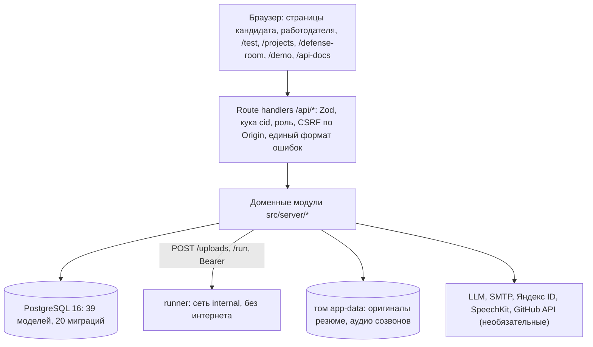

# ФСП Карьера — сопроводительная документация

> **Перед экспортом в PDF:** этот документ сохраняет описание и числа снимка 10 октября. [Аудит 11 октября](../compliance-audit-2026-10-11.md) проверяет более свежий `main` (3e4bee56): политика теста уже `adr-0002-v7`, health стенда показывает `openai-chat`, OpenAPI содержит 115 путей/142 операции, реализованы поля резюме, отдельные согласия с отзывом, две защиты и слоты, ATS webhook и антифрод-концепт; есть ограниченный нагрузочный замер на 50 VU. Метрики v3–v5 нельзя подписывать как замер v7; ниже описанные ограничения нужно сверить с аудитом. Итоговый формат сдачи — **PDF**, презентация нужна уже 11 октября, при доступном демо видео необязательно ([разъяснения организаторов](../organizer-updates.md)). Сам Markdown не подтверждает готовность и отправку комплекта.

ЛЦТ 2026, специальный трек ФСП: «Цифровая платформа-агрегатор ИТ-вакансий с верифицированным профилем
достижений участника ФСП». Документ по ТЗ, раздел 3.4. Актуальность: **10 октября 2026 года** (МСК),
код — `platform/` командного репозитория, политика теста `adr-0002-v4`, архитектура ступеней оценки —
[ADR 0003](../decisions/0003-three-stage-assessment.md).

| | |
|---|---|
| Стенд | https://fsp2.ru (проверка — `GET /api/health`) |
| Пароль стенда | `oXKPEAxv0t45CgoX` — один раз на https://fsp2.ru/site-access (без логина; кука на 30 дней), затем открывается весь сайт |
| Вход для жюри | https://fsp2.ru/demo — готовые кандидаты, работодатель и «Новый пользователь» (онбординг с нуля) |
| API | Swagger UI — https://fsp2.ru/api-docs, спецификация — `GET /api/openapi`, файл — [`docs/openapi.yaml`](../openapi.yaml) (89 путей, 109 операций) |
| Запуск | `docker compose up --build` в `platform/` (раздел 8) |
| Пути пользователей | [`docs/cjm.md`](../cjm.md) — кандидат и работодатель по ступеням, где виден псевдоним |

**Суть.** Обратная механика найма в три ступени. Кандидат проходит онбординг и **адаптивный тест на грейд** — он
присваивает категорию «направление × подкатегория × грейд»; затем **квалифицирующий созвон** с ИИ (карта глубины по
темам профиля), **проектное задание** из ленты обезличенных заданий (автопроверка скрытыми тестами в песочнице и
рубрика) и **защиту проекта** в комнате, где ИИ спрашивает по его же коду, а работодатель может подключиться голосом.
Работодатель описывает потребность, получает ранжированную подборку с объяснением каждой позиции и сам отправляет
приглашение с вилкой зарплаты; приглашение на защиту сданного проекта — это приглашение в смысле ТЗ. Контакты и имя
кандидата открываются только после принятия приглашения; до этого — псевдоним. Профиль состоит из **утверждений с
доказательствами**: каждое привязано к дословной цитате источника, а уровень доказанности ставит код. Языковая модель
извлекает, спрашивает и предлагает, **решения принимает код**: грейд — IRT-модель без LLM, балл проекта — скрытые тесты,
ранжирование — детерминированная формула. Автоматического вердикта «фейк» нет: слабая защита при сильном проекте —
флаг работодателю, не понижение (ст. 16 152-ФЗ).

**Что сверх ТЗ.** Грейд **Senior** (в ТЗ — Junior и Middle; организаторы подтвердили, что достаточно двух грейдов),
четыре направления с 18 подкатегориями (54 категории, таблица — § 2.1) (организаторы: «двух специализаций достаточно» — нижняя планка), созвон, проект
и защита как ступени оценки. Эти части названы в тексте «сверх ТЗ»; обязательный MVP от них не зависит.

**Как читать пометки.** «Имитация» — функция показана на вымышленных данных, потому что настоящего
источника нет (API ФСП, реестр компаний). «Предложение» — число или правило выбрано нами и не
откалибровано на людях. «План» — описано, но не реализовано. «Не измерено» — цифры нет. Каждое число дано со
ссылкой на источник и команду, которая его воспроизводит.

**Режим стенда на 10.10.** `/api/health` отвечает `"llm":"stub"`: ключ языковой модели не задан,
поэтому консультант, интервьюеры, оценщики созвона и защиты и генерация условия проекта работают в демо-режиме без
модели (словарь каталога, шаблонные и детерминированные ответы, раздел 1.4). Тест, категория, подбор, приглашения и
скрытые тесты проектов от модели не зависят и работают полностью.

---

## 1. Функциональная и компонентная архитектура

Требования: R-N-04 (разделение слоёв), R-N-01 (дешёвый сервер), R-N-07 (безопасность), R-C-14 (152-ФЗ).
Подробно — [`docs/modules.md`](../modules.md), [`docs/platform.md`](../platform.md).

### 1.1. Функциональная архитектура

Два кабинета и общий вход. Роль (кандидат или работодатель) пользователь выбирает один раз в
онбординге; на одной учётке можно завести и вторую роль ([ADR 0004](../decisions/0004-role-switching.md)).

| Кабинет | Что делает пользователь | Требования |
|---|---|---|
| Вход | Регистрация по почте с кодом подтверждения, вход по паролю, восстановление пароля; вход через Яндекс ID (дополнительно); демо-вход `/demo` для жюри | R-D-04, R-N-07 |
| Онбординг (оба) | Согласие на обработку ПДн → роль → опрос в чате. Кандидат: цель, документы, ФСП ID, **направление и подкатегория**, грейд, стек, формат работы, город, зарплата, контакт. Работодатель: компания, ИНН, отрасль, описание, контакт, первая потребность | R-C-04, R-C-05, R-C-14, R-E-01, R-E-02 |
| Кандидат | Резюме (PDF/DOCX) и ссылки → утверждения с цитатами → подтверждение кнопками → профиль по уровням доказанности → **тест на грейд → категория** → история попыток → входящие приглашения: принять или отклонить → приватность | R-C-02, R-C-06…R-C-09, R-C-11, R-C-13, R-C-16 |
| Кандидат: ступени 1–3 (сверх ТЗ) | **Созвон** с ИИ → карта глубины; **лента заданий** без названия компании и зарплаты → сабмит репозитория → результат скрытых тестов и рубрики; **защита проекта** в комнате по приглашению работодателя | доп. функционал, критерий 2 |
| Кандидат: консультант | Чат-агент: объясняет пробелы, рекомендует тест и задания, сверяет с вакансиями платформы. Писать в профиль не может | доп. функционал |
| Работодатель | Потребности (направление, подкатегория, грейд, стек, команда, вилка, требования из каталога) → подборка с объяснением → поиск по всей базе с фильтрами → приглашение с вилкой → статусы | R-E-02…R-E-05, R-E-07, R-M-01…R-M-04, R-D-01…R-D-03 |
| Работодатель: ступени 1–3 (сверх ТЗ) | Задание к потребности (шаблон, обязательные критерии из каталога, пожелания) → сабмиты под псевдонимом с результатом → «позвать на защиту» (= приглашение ТЗ с вилкой) → комната защиты: вход голосом или текстом, мьют ИИ, очередь вопросов кандидату | доп. функционал |
| Работодатель: помощник | Чат-агент поверх тех же функций подбора: подбери, объясни место, черновик приглашения. Отправляет только человек | доп. функционал |

Сквозной путь, который требует ТЗ 3.3, — в приложении А; пути по ступеням с указанием, где виден псевдоним, —
[`docs/cjm.md`](../cjm.md).

**Три ступени оценки** (ADR 0003; все три — сверх ТЗ, категорию по-прежнему задаёт только тест):

```text
онбординг → подкатегория → тест (v4, Junior/Middle/Senior) → созвон (карта глубины)
  → лента заданий (обезличенные, ≤ 3 активных) → сабмит (GitHub + журнал ИИ) → runner (скрытые тесты) → рубрика LLM
  → работодатель видит сабмиты под псевдонимом → «позвать на защиту» = приглашение ТЗ (название, описание, вилка)
  → кандидат принимает → комната защиты (QLC по его коду; WebRTC или текст) → вердикт по рубрике A-02 и флаги
```

- **Лента и R-D-01/02.** Кандидат видит задание без компании и зарплаты, пока не получил приглашение: задание — задача
  для защиты, а не вакансия. Приглашение, после которого открываются контакт, запись и комната, всегда содержит название,
  описание, вилку и способ связи — это и есть приглашение ТЗ, расхождения с R-D-01/02 нет. Приглашать можно и без задания.
- **Балл runner — сигнал, не доказательство.** Код кандидата исполняется в одном процессе с тестовым раннером и в принципе
  может подделать результат; страхуют рубрика LLM по критериям работодателя (пояснения и флаги, не балл) и защита проекта,
  где вопросы строятся по его же коду.
- **Слабая защита при сильном проекте** — флаг `strong_project_weak_defense`, понижения и вердикта «фейк» нет.

### 1.2. Компонентная архитектура

Монолит Next.js с явными слоями (ТЗ 3.5 это допускает) и один вспомогательный сервис — песочница автопроверки `runner`.
Контейнеры: приложение, PostgreSQL, почтовый сервер Mailpit, runner; на стенде впереди стоит Caddy с HTTPS.



```text
Доменные модули src/server/*  (чистые функции + сервисы над БД)
   auth · mail            вход по почте, Яндекс ID, роли, согласие, письма
   onboarding · directions сценарий опроса, ИНН; 4 направления, 18 подкатегорий, 3 грейда
   collector · uploads    PDF/DOCX/HTML, SSRF-фильтр, скрытый текст, маскирование ПДн, демо-ФСП, оригиналы файлов
   claims                 каталог 120 утверждений, извлечение (LLM) → проверка цитаты (код), уровни
   test                   генераторы заданий (492 семейства), IRT 2PL, политика adr-0002-v4        ← без LLM
   call                   ступень 1: квалифицирующий созвон, карта глубины, запись, согласие
   project · runner       ступень 2: шаблоны, лента, сабмит, скрытые тесты в песочнице, рубрика
   defense-room           ступень 3: QLC по репозиторию, комната, очередь вопросов, WebRTC-сигналинг
   employer · recommend   потребности, ранжирование, приглашения, приватность                    ← без LLM
   agent · agent/employer консультант (18 инструментов), помощник работодателя (7)
   defense                защита утверждения: интервьюер и оценщик (LLM), порог — код
   llm                    один интерфейс над провайдерами stub / openai-chat / yandex, журнал вызовов
```

Подробно по модулям (модели, маршруты, env, ограничения) — [`docs/modules.md`](../modules.md), поток и границы доверия —
[`docs/platform.md`](../platform.md).

Принцип: **модель предлагает, код решает.** Утверждение попадает в профиль, только если оно из
закрытого каталога, его цитата дословно есть в видимом тексте источника (проверяет код) и кандидат
нажал «да». У агентов нет инструментов записи в профиль и отправки от имени пользователя — это
проверяет тест `tests/unit/agent/tools.test.ts`. Грейд, балл проекта и подбор считаются без модели.

### 1.3. Безопасность и персональные данные (R-N-07, R-C-14, R-C-16, R-E-07)

- **Сессия** — HMAC-подписанная кука `cid` (HttpOnly, SameSite=Lax, Secure на HTTPS, 30 дней); смена
  пароля отзывает выданные сессии. **Пароли** — scrypt (N = 2¹⁵) с солью; коды подтверждения хранятся
  как HMAC-хэш, живут 15 минут, допускают 5 попыток. Токены Яндекса не хранятся.
  ([ADR 0001](../decisions/0001-auth-yandex-id.md))
- **Без перечисления аккаунтов:** неверная почта и неверный пароль дают одинаковый ответ за одинаковое
  время; «забыли пароль» всегда отвечает 200.
- **Роли и владение:** guard на каждом маршруте; чужой объект неотличим от несуществующего (404).
- **Приватность кандидата:** до принятия приглашения работодатель видит псевдоним «Кандидат #XXXXXX»,
  категорию, утверждения формулировкой каталога, отметку ФСП, оценки созвона по темам и результат своего
  проектного задания. Имя, контакты, цитаты из резюме, транскрипт и запись созвонов, ссылка на репозиторий
  (раскрывает логин GitHub) закрыты; решает это сервер (`employer/privacy.ts`, `call/access.ts`,
  `defense-room/access.ts`). Кандидат может скрыть себя из подборок.
- **152-ФЗ:** согласие с версией текста и временем (`Consent`); без согласия онбординг не завершить.
  Контакты в тексте резюме маскируются до сохранения и до модели; оригинал файла хранится на диске (том `app-data`)
  только для владельца и удаляется им же. LLM-провайдеры, распознавание и озвучка — в РФ (Yandex Cloud).
- **Правовые документы (R-C-14):** публичные страницы без входа - `/privacy` (политика, ст. 18.1), `/terms` (соглашение
  кандидата, без согласий на ПДн), `/employer-terms` (оферта работодателя), `/ai` (как работает ИИ, как оспорить оценку),
  `/consent` (согласие). Тексты - заготовки с оператором-заглушкой и плашкой «черновик», юрист их не вычитывал; код -
  `src/lib/legal/*`. Основание для отдельного согласия - ч. 1 ст. 9 152-ФЗ с 1.09.2025 (согласие оформляется отдельно от иных
  документов); это норма по тексту закона, а выбор набора документов - наш вывод, обоснование и пометки достоверности -
  ресёрч `docs/research/competitors/topics/consent-152fz.md`. Решение по согласиям - ADR 0005 (лейн `consent`).
- **Запись созвонов:** отдельный пункт согласия перед первым звонком (версия текста в `Consent`); транскрипт — в БД,
  аудио кандидата — файлы вне БД; кандидат слышит запись всегда, работодатель — только после принятого
  приглашения. Оценщик созвона и защиты не видит резюме, код и результат тестов, только пары «вопрос → ответ».
- **Автоматических решений о человеке нет** (ст. 16 152-ФЗ): вердикта «фейк» не выдаётся, слабая защита при сильном
  проекте — флаг работодателю.
- **Код кандидата — только в песочнице runner:** отдельный контейнер без интернета (внутренняя сеть, режим шлюза
  `isolated`), без `docker.sock`, ФС только на чтение, лимиты 1,5 ГБ памяти / 0,8 CPU / 512 процессов, сервис не от
  root, задание под отдельным uid с `NoNewPrivs`; в окружении runner — только общий токен. Скрытые тесты кандидату не
  выдаются, `logTail` ему не показывается. Граница — общее ядро с хостом (без gVisor и Firecracker), это сознательный
  компромисс хакатона. Подробности — `platform/runner/README.md`.
- **Внешние данные:** SSRF-фильтр сборщика (проверка всех DNS-адресов, привязка соединения к
  проверенному IP) — и для архива репозитория, который приложение скачивает для runner; разбор файлов в отдельном
  потоке с лимитами, скрытый текст PDF/HTML не может стать цитатой, внешний текст, код репозитория и журнал ИИ
  передаются модели как недоверенные данные.

Ограничения: лимиты попыток входа хранятся в памяти процесса и сбрасываются при перезапуске. Роль
пользователь выбирает сам, верификации работодателя нет (R-D-05 её не требует; концепция — приложение Б).

### 1.4. Режимы работы и имитации

| Что | Как устроено | Статус |
|---|---|---|
| Языковая модель | `LLM_PROVIDER=stub` по умолчанию; с ключом — DeepSeek V4 Flash в Yandex Cloud (выбран по замеру, раздел 4.4) | на стенде 10.10 — stub |
| Демо без модели | `LLM_STUB_DEMO=true`: извлечение по словарю каталога, консультант отвечает шаблонами. Проверка цитат, уровни, тест и подбор работают тем же кодом | на стенде |
| ФСП ID и достижения | Привязка в настройках по OIDC (Authorization Code + PKCE) к встроенному моку ФСП ID; достижения демо-участников помечены «демонстрационные» | **имитация провайдера**, поток настоящий (раздел 5) |
| Проверка компании | ИНН проверяется по контрольной сумме ФНС; «найдено в реестре» помечено «демо», запроса в ЕГРЮЛ нет | **имитация** реестра |
| PDF-профиль (R-C-03) | `/profile` с печатными стилями, кнопка «Печать / PDF» — браузер сохраняет PDF | **имитация**: серверной генерации нет |
| Демо-резюме и пул кандидатов | 3 демо-кандидата с PDF-резюме и вымышленными GitHub-профилями; 8 синтетических кандидатов работодателя. У 4 из них категория поставлена сидом, без теста | вымышленные данные |
| Почта | Свой SMTP-клиент (TLS 465). Локально письма видны в Mailpit (http://localhost:8025) | на стенде зависит от SMTP-провайдера (раздел 8.3) |
| Яндекс ID | Свой OAuth 2.0 code flow + PKCE; включается ключами `YANDEX_CLIENT_ID/SECRET` | на стенде 10.10 не подключён |
| Автопроверка проектов | Сервис `runner`; без `RUNNER_URL` приложение использует stub-runner: счёт по числу тестов шаблона, не по коду кандидата | на стенде 10.10 — проверить, что `RUNNER_TOKEN` задан (иначе runner отвечает 503, остальной стенд работает) |
| Условие и рубрика проекта | LLM `project_spec` / `project_rubric`; при `LLM_PROVIDER=stub` — детерминированная сборка | на стенде — детерминированная |
| Созвон и защита проекта | Интервьюер, оценщик A-02 и QLC-вопросы на модели; на stub — детерминированные ответы по контексту | на стенде — stub; на реальной модели не проверялось, валидация персонами — раздел 4.8 (дополняется) |
| Голос | Ввод — Yandex SpeechKit или Web Speech браузера, озвучка — SpeechKit TTS; без ключей — текст. Аудио комнаты — WebRTC P2P через публичный STUN, **TURN нет** | на стенде зависит от ключей и сети участников |
| Интервалы теста | `TEST_DEMO_INTERVALS=true`: 2 и 1 минута вместо 30 и 14 дней, чтобы жюри увидело правило | на стенде (по стартовому `.env`) |
| Слой жюри над тестом | `JURY_INSIGHTS=true`: плашка «Только для жюри» со счётчиками сигналов, ловушкой и разбором индекса честности; на проде `false`, кандидату проверка не раскрывается | на стенде (по стартовому `.env`) |

---

## 2. Механика тестирования и устойчивость к распространению заданий

Требования: R-T-01…R-T-05, R-C-05…R-C-09, R-M-01. Решение —
[ADR 0002](../decisions/0002-grade-test.md), код — `platform/src/server/test/`, экран — `/test`.

### 2.1. Справочник направлений, подкатегорий и грейдов (R-T-05)

Четыре направления, **18 подкатегорий**, три грейда — **54 категории**. Категория кандидата = **направление × подкатегория × грейд**. Источник списка — `platform/src/lib/directions.ts` (`SUBCATEGORIES`, R-T-05), таблица снята с кода 11.10.2026 вечером; «Fullstack» — не отдельная категория, а представление в поиске работодателя (есть категории и в backend, и в frontend; грейд — меньший из двух).

| Направление | Подкатегория | Название | Что проверяем | Семейств заданий J / M / S | Шаблонов проекта J / M / S |
|---|---|---|---|---|---|
| backend | `backend.web-api` | Web API | CRUD, валидация, ошибки, SQL-схема и тесты | 9 / 9 / 8 | 2 / 1 / 1 |
| backend | `backend.integrations` | Интеграции | Внешние API и очереди: ретраи, таймауты, идемпотентность, маппинг форматов | 9 / 9 / 8 | 1 / 1 / 1 |
| backend | `backend.highload` | Highload | Профилирование и ускорение: кэш, N+1, фоновые задачи | 9 / 9 / 8 | 1 / 1 / 1 |
| backend | `backend.data-model` | Модель данных | Миграции, транзакции, конкурентные обновления | 9 / 9 / 8 | 1 / 1 / 1 |
| frontend | `frontend.ui-app` | UI-приложение | SPA из макета: компоненты, формы, состояние, роутинг | 9 / 9 / 8 | 2 / 1 / 1 |
| frontend | `frontend.design-system` | Дизайн-система | Библиотека компонентов, доступность, темизация | 9 / 9 / 8 | 1 / 1 / 1 |
| frontend | `frontend.web-perf` | Производительность | Профилирование страницы, бандл, SSR и метрики | 9 / 10 / 8 | 1 / 1 / 1 |
| frontend | `frontend.realtime` | Realtime | WebSocket/SSE, оптимистичные обновления, восстановление соединения | 9 / 10 / 8 | 1 / 1 / 1 |
| ai | `ai.llm-apps` | LLM-приложения | Промпты, структурированный вывод, RAG, tool-use, оценка качества | 9 / 9 / 8 | 1 / 1 / 1 |
| ai | `ai.ai-integration` | AI-интеграция | LLM/ML-сервис в существующей системе: отказы, наблюдаемость, ПДн, fallback | 9 / 9 / 8 | 1 / 1 / 1 |
| ai | `ai.ml-engineering` | ML-инженерия | Обучение и оценка модели, валидация без утечек, воспроизводимый пайплайн | 9 / 10 / 8 | 1 / 1 / 1 |
| ai | `ai.mlops` | MLOps | Модель в сервисе: версии, мониторинг дрейфа, переобучение, откат | 9 / 9 / 8 | 1 / 1 / 1 |
| ai | `ai.data-science` | Data Science | Аналитика и статистика: A/B, прогноз, интерпретация | 9 / 9 / 8 | 1 / 1 / 1 |
| ai | `ai.bi-analytics` | BI-аналитика | Метрики, SQL-витрины, дашборды, интерпретация для бизнеса | 8 / 5 / 5 | 1 / 1 / 1 |
| engineering | `engineering.data-eng` | Data Engineering | ETL/ELT, качество данных, витрины, оркестрация | 9 / 9 / 8 | 1 / 1 / 1 |
| engineering | `engineering.devops` | DevOps | CI/CD, Docker/K8s, IaC, наблюдаемость | 9 / 9 / 8 | 1 / 1 / 1 |
| engineering | `engineering.qa-automation` | QA-автоматизация | Автотесты API/UI, тест-дизайн, стабильность | 9 / 9 / 8 | 1 / 1 / 1 |
| engineering | `engineering.sre` | SRE | Инциденты, разбор, ёмкость | 9 / 9 / 8 | 1 / 1 / 1 |
| **Итого** | **18** | | | **463** привязаны к подкатегориям (+29 общих, всего 492) | **56** (по 2 Junior — у `backend.web-api` и `frontend.ui-app`) |

- **Тест отдельный на подкатегорию** (решение 10.10 по калибровке: при общем тесте на направление узкий Junior одной
  подкатегории подтверждался в 60 %). Подкатегория обязательна для старта теста; сопоставимость результатов (R-T-02) —
  **внутри подкатегории**. Пул — семейства заданий подкатегории; подкатегория без полного банка (минимум 6 Junior + 4 Middle +
  4 Senior) показывает «тест пока недоступен». Сейчас банк полон во всех 18 (у `ai.bi-analytics` банк меньше остальных: 18 семейств против 26–27, параметры экспертные, подогнаны под симуляцию).
- **Senior — сверх ТЗ.** В ТЗ два грейда (Junior, Middle), организаторы подтвердили, что двух достаточно
  ([Q01](../questions-for-organizers.md#q01)); четыре направления вместо двух — то же: «двух специализаций достаточно» — нижняя
  планка. Если жюри считает по ТЗ, значимы Junior и Middle по backend и frontend; остальное — дополнительные категории.
- «Отрасль» в опросе — ИТ-направление, так её трактуют организаторы (там же).

### 2.2. Задания — параметризованные генераторы (R-T-01, R-T-02, R-T-03)

- **492 семейства (шаблон-генератор)**: по 26–27 на каждую из 17 исходных подкатегорий (второй банк 11.10), 18 у `ai.bi-analytics`, 29 общих; по грейдам — в таблице § 2.1. Каждое
  привязано к утверждениям каталога (`catalogIds`, 142 записи) — так тест связан с профилем и подбором. Senior-задания — проектные
  решения, компромиссы, диагностика по неполным данным, границы применимости (b 1,0–1,7).
- **Экземпляр уникален для попытки.** Несущественные параметры (имена, числа, порядок строк) берутся
  из seed, параметры, задающие сложность, зафиксированы в шаблоне. Один шаблон даёт от 48 до 5·10⁸
  экземпляров.
- **Ключ ответа считает код генератора.** LLM не генерирует задания и не проверяет ответы, поэтому
  сложность сопоставима между кандидатами, а проверка объективна. Это и есть ответ на условие ТЗ
  «генерация нейросетью не гарантирует сопоставимую сложность».
- **Форматы:** число, вывод программы (строка/порядок), номер строки с дефектом в коде, список номеров.
  Выбора из вариантов нет: угадывание пренебрежимо мало. Ключ хранится только на сервере.

### 2.3. Адаптивный алгоритм

| Шаг | Правило | Константа в коде |
|---|---|---|
| Модель | 2PL IRT: P(верно \| θ) = 1 / (1 + exp(−a(θ − b))). Оценка θ — EAP по сетке 81 узел на [−4; 4], априорное N(0, 1); SE — корень апостериорной дисперсии | `irt.ts` |
| Выбор задания | Из непоказанных шаблонов, не превышающих 40 % заданий на одно утверждение каталога, берутся **3 с наибольшей информацией Фишера** при текущей θ̂ (randomesque), из них одно — по seed попытки; при равенстве — менее показанное | `RANDOMESQUE = 3`, `MAX_SHARE_PER_CATALOG = 0.4` |
| Остановка | Не раньше 7 и не позже 10 заданий основной фазы; между ними — когда P(θ > порог) ≥ 0,9 или ≤ 0,1 либо SE ≤ 0,4 | `MIN_ITEMS`, `MAX_ITEMS`, `SE_STOP` |
| Пороги грейдов | Junior: θ > **−0,7**; Middle: θ > **−0,1**; Senior: θ > **+0,8** (предложение, раздел 2.6) | `GRADE_CUT` |
| Решение | Грейд подтверждён, если P(θ > порог заявленного) ≥ **0,8** | `CONFIRM_PROB` |
| Дозадавание Junior | Если заявленный грейд не подтверждён, а P(θ > −0,7) попадает в (0,2; 0,8), добавляется **до 3 Junior-заданий** (стоп при P ≥ 0,9 или ≤ 0,1); потолок такой попытки — 13 заданий. Включается при заявке Junior и Middle | `JUNIOR_PROBE_MAX = 3`, `MAX_ITEMS_TOTAL = 13` |
| Заявка Senior | Основная фаза — только Senior-задания подкатегории (в Senior-пуле 4 семейства); если Senior не подтверждён, а P(Middle) > 0,2 — **до 4 заданий Middle** (стоп при P(Senior) ≥ 0,8 или P(Middle) ≤ 0,1). Без этого Middle подтверждал Senior в 18–47 % | `MIDDLE_PROBE_MAX = 4`, `middle_probe` |
| Грейд ниже в один клик | Заявленный не подтверждён, но P(θ > порог грейда ниже) ≥ 0,8 → кандидату предлагается грейд ниже (Senior → Middle, Middle → Junior) **по той же попытке**; без его согласия категория не меняется | `confirm-junior`, `offeredGrade` |
| Итог | Решение записывает `CandidateCategory {специализация, грейд, источник: тест}`; верно решённые задания поднимают подтверждённые утверждения кандидата с теми же `catalogIds` до уровня «платформа» | `service.ts`, `finalize` |

На экране: одно задание, прогресс «задание k, всего 7–10» без подсказки о сложности, мягкий таймер.
При дозадавании — нейтральная плашка «Ещё несколько заданий для точности», промежуточный итог не
раскрывается. Итог: подтверждён или нет, решено k из n, уверенность в процентах, разбор своих заданий
с ключами (чужим не поможет — у них другие параметры).

**Повторяемость.** Seed попытки задаёт экземпляры и выбор; при тех же ответах получаются тот же θ̂ и
тот же грейд. В грейде нет ни случайности, ни LLM. Это проверяет
`tests/integration/test/grade-test.test.ts`.

### 2.4. Пересдача и интервалы (R-C-08, R-C-09)

- **Принудительного понижения нет:** неудачная попытка не снимает подтверждённую категорию.
- Не прошёл заявленный грейд — можно сразу пройти грейд ниже или подтвердить Junior по той же попытке.
- Смена грейда — не чаще раза в **30 дней**, пересдача того же грейда — через **14 дней**. Брошенная
  попытка интервалы не запускает. Интервалы — наше предложение (ТЗ оставляет выбор команде). На стенде
  для показа они сокращены до 2 и 1 минуты.

### 2.5. Почему утечка заданий не ломает тест (R-T-01)

1. **Опубликованный экземпляр бесполезен:** у следующей попытки другие параметры и другой ключ.
2. **Ключ не уходит на клиент** до завершения попытки; разбор после теста показывает только свои
   экземпляры.
3. **Адаптивность и randomesque:** разные кандидаты и разные попытки получают разные наборы шаблонов.
4. **Интервал пересдачи** не даёт перебирать варианты.

Честные пределы защиты (цифры — [validation-results.md](../validation-results.md), разделы
«Чувствительность» и «Утечка трюка»). **Эти цифры измерены на прежнем банке (12 семейств на направление, до перехода на
подкатегории); для банка 14–15 семейств на подкатегорию экспозиция и утечка трюка не перемерялись — не измерено.**

- **Банк мал.** На прежнем банке самый частый шаблон виден в 94 % попыток, две попытки одного кандидата совпадают по
  шаблонам примерно на 81 %. В новом банке попытка показывает 4–13 из 14–15 семейств подкатегории, повторная попытка видит
  почти тот же набор семейств (экземпляры другие, ключи другие). Анти-утечка держится на разных экземплярах, а не на ротации.
- **Утечка трюка** (кандидат знает идею шаблона, а не экземпляр): если известны трюки 30 % шаблонов,
  ложное подтверждение в θ-симуляции растёт до 52–56 % на популяции `persona` и до 10–12 % на
  `legacy`. Это предел защиты; его закрывает рост банка и вывод
  шаблонов из оборота (план).
- **Лучший из трёх попыток без интервала:** ложное подтверждение 57–59 % (`persona`) и 7–8 %
  (`legacy`) — поэтому интервал пересдачи нужен.

### Граница доказательств: защита от нейросети

Текстовый тест нельзя защитить от нейросети в соседнем окне, и мы этого не обещаем: эту проблему не решает никто, а сигналы вкладок, вставки и person-fit ловят случайного, а не намеренного. Поэтому тест у нас - предварительная калибровка грейда, а единственные, кто проверяет умение вне теста, - мы: созвон с ИИ-интервьюером, проект на скрытых тестах и защита по собственному коду. Уникальные экземпляры и ротация заданий защищают от слива ответов, не от модели. Эффективность против моделей мы не измеряли; организаторы подтвердили, что обязательна только устойчивость к распространению заданий ([V04](../meetings/2026-10-06/questions-and-answers.md#v04-обязательна-ли-защита-от-списывания-и-подсказок-в-mvp)).

### 2.6. Что в механике выбрано нами, а не измерено

- Параметры заданий `a`, `b` — **экспертные** (`paramsSource = expert`), на людях не оценены.
  Процедура живой разметки (1 час, 2–3 эксперта, метод Ангоффа) описана в
  [test-calibration.md](../test-calibration.md), **не проведена**.
- Пороги θ (−0,7, −0,1 и +0,8 для Senior) и порог 0,8 — предложение. Порог Junior выбран перебором на симуляции
  персон (раздел 4.1), Middle — граница между синтетическими популяциями, Senior (+0,8; ADR 0003 предлагал +0,6) —
  по персонам: при Senior-пуле цифры одинаковы на +0,6…+1,0.
- Подбор a, b под цели персон делался на тех же персонах, на которых цели проверяются; независимого набора нет.
- Симуляция показывает свойства механики **при заданных параметрах**, но не доказывает, что задания
  измеряют умение реальных людей.

### 2.7. Из вакансий в задания (R-T-04)

ТЗ просит показать, как система формирует задания и тесты из описаний вакансий. **Тест на категорию код из вакансии не
собирает**: он единый для категории (организаторы: «первичный тест единый по категории», [Q09](../questions-for-organizers.md#q09);
после перехода на подкатегории «категория» включает подкатегорию), а связь с вакансией идёт через общий каталог
утверждений. **Проект под потребность собирается из вакансии** (сверх ТЗ): работодатель выбирает шаблон по направлению,
подкатегории и грейду потребности, отмечает обязательные критерии из каталога и пишет пожелания, модель переписывает
легенду в его домен и строит рубрику, а проверка идёт по неизменному контракту шаблона — поэтому балл сравним между
кандидатами. Так R-T-04 закрыт для проектов и частично для теста:

1. Потребность работодателя хранит требования как **id утверждений каталога с весом 1–3**
   (`Vacancy.needs`); форма и помощник берут их только из каталога своей специализации.
2. Каждый шаблон-генератор помечен `catalogIds` — утверждениями, которые он проверяет.
3. Пересечение «требования вакансии ∩ `catalogIds` шаблонов» даёт набор шаблонов под вакансию;
   генераторы создают из них уникальные экземпляры, а движок отбирает их тем же правилом
   (информация при θ̂, randomesque, лимит доли утверждения).
4. Верно решённые задания поднимают утверждения до уровня «платформа» с весом 1,0 в покрытии
   подбора — то есть решённый тест прямо поднимает кандидата в подборке под вакансию с этими
   требованиями (раздел 3.3).

Пересечение для 8 демо-вакансий из сида (`prisma/seed/recommend.ts`) с банком генераторов. Посчитано
сравнением списков id в коде на 10.10 **по 24 исходным семействам backend/frontend, до расширения банка до 241**; для
нового банка не пересчитано. Это разбор, а не работающая функция:

| Вакансия | Требований | Покрыто шаблонами | Шаблоны (грейд) | Не покрыто банком |
|---|---|---|---|---|
| Backend Junior, «Северный Поток» | 7 | 4 | sql-rowcount (J), http-semantics (J), n-plus-one (J), schema-constraint (J), index-choice (M) | be.lang-core, be.error-handling, common.git |
| Backend платежей Middle | 6 | 6 | payment-retry, isolation-anomaly, delivery-semantics, index-choice, retry-policy (M), http-semantics (J) | — |
| Backend Junior, «Гранит» | 6 | 4 | http-semantics, find-bug-idor, shell-output, schema-constraint (J) | be.framework, be.config-secrets |
| Backend Middle, «Гранит» | 6 | 3 | isolation-anomaly, cache-consistency (M), find-bug-idor (J) | be.integration-tests, be.observability, be.distributed-consistency |
| Frontend Junior, «Лабиринт» | 6 | 5 | js-closure, js-array-output, css-flex, html-semantics, dom-events (J), event-loop, state-bug (M) | fe.forms |
| Frontend Middle, «Лабиринт» | 6 | 5 | ts-typecheck, api-client-race, state-bug, web-vitals (M), html-semantics (J) | fe.component-tests |
| Frontend Junior, «Северный Поток» | 6 | 4 | js-closure, js-array-output, dom-events (J), event-loop, api-client-race (M) | fe.routing, common.git |
| Frontend Middle, «Гранит» | 6 | 2 | api-client-race, state-bug (M) | fe.architecture, fe.ssr, fe.e2e-tests, fe.bundler |

Итого банк покрывает 33 из 49 требований демо-вакансий. Непокрытые требования (тесты, наблюдаемость,
SSR, сборщики) — список шаблонов, которые нужно добавить в банк. Задания под конкретную вакансию
после приглашения (необязательный блок «регулярных заданий», R-C-10) — **план**; проектное задание из ленты (ступень 2) —
ближайший реализованный аналог, но это не регулярные задания; в банке рекомендаций
есть 16 карточек заданий, но проверки решений по ним нет.

---

## 3. Механика подбора и логика категоризации

Требования: R-M-01…R-M-04, R-E-02…R-E-05, R-E-07, R-C-11, R-C-13, R-C-16, R-D-01…R-D-03. Код —
`platform/src/server/employer/` (`ranking.ts`, `weights.ts`, `privacy.ts`), описание —
[platform.md, «Кабинет работодателя»](../platform.md#кабинет-работодателя-lane-employer).

### 3.1. Сценарий контакта: инициатива у работодателя

1. Работодатель описывает потребность: направление, подкатегория, грейд, стек, команда, вилка «от–до» в ₽,
   требования из каталога с весами (R-E-02, R-D-01).
2. Получает подборку: кандидаты отсортированы по баллу, у каждого строка «почему здесь» (R-E-03,
   R-M-03). Либо ищет по всей базе с фильтрами (R-E-04).
3. Уточняет фильтры: каждое уточнение открывает новый URL, прежние выдачи остаются в истории и в
   списке «Прежние выдачи» (R-M-04).
4. Отправляет приглашение конкретному кандидату. Вилка и описание обязательны, привязка к вакансии —
   нет (R-E-05, R-D-02). Ограничения: одно открытое приглашение компании этому кандидату; не больше
   20 приглашений в сутки на компанию (предложение).
5. Кандидат ещё **до ответа** видит компанию, описание, вилку и способ связи компании. Он принимает
   или отклоняет приглашение (R-C-11). Статусы `отправлено → просмотрено → принято / отклонено` видят
   обе стороны (R-D-03); о новом приглашении и об ответе приходит письмо.
6. Только после «принято» работодатель видит имя и контакт кандидата (R-E-07).

**Вариант со ступенями (сверх ТЗ).** Работодатель может сначала опубликовать к потребности проектное задание (шаблон,
обязательные критерии, пожелания). Кандидат подходящего направления и грейда не выше его категории видит задание в ленте **без названия
компании и зарплаты**, берёт его (не больше трёх одновременно), сдаёт репозиторий. Работодатель видит сабмиты под псевдонимом
с результатом автопроверки и жмёт «позвать на защиту»: создаётся приглашение с описанием и вилкой — то же, что в п. 4–6, —
и ожидающая защита. После принятия открываются имя, контакт, комната защиты и запись. Приглашение по-прежнему можно
отправить и без задания, прямо из подборки.

### 3.2. Категоризация

- **Категорию даёт только тест** (R-M-01): «направление × подкатегория × грейд» (Junior / Middle / Senior) из `CandidateCategory`,
  источник — тест. Созвон, проект и защита категорию **не меняют**: они добавляют доказательства (карту глубины, результат
  проекта, вердикт защиты) к профилю. Самоописание в резюме и ответы онбординга категорию не присваивают. Консультант может
  рекомендовать грейд для теста, но решает кандидат (R-C-05).
- **Утверждения с уровнем доказанности** — вторая ось профиля. Уровень ставит код по типу источника,
  модель и кандидат его не меняют:

| Источник | Уровень | Вес в покрытии (предложение) |
|---|---|---|
| Резюме, документ, чат | со слов | 0,25 |
| GitHub, ссылка, Stack Overflow | артефакт | 0,5 |
| Codeforces, ФСП — только при подтверждённом владении аккаунтом | третья сторона | 0,75 |
| Решённое задание теста, защита утверждения, тема, подтверждённая созвоном | платформа | 1,0 |

Подтверждения владения аккаунтом в коде нет, поэтому уровень «третья сторона» сейчас не выдаётся:
GitHub, Codeforces и ФСП дают максимум «артефакт». Смежное утверждение каталога засчитывается вдвое
слабее.

### 3.3. Ранжирование (R-M-02, R-M-03)

Детерминированная формула без модели (`scoreCandidate` в `ranking.ts`):

```text
покрытие = Σ(вес требования × вес уровня утверждения) / Σ(вес требования)     — по подтверждённым утверждениям
балл     = (покрытие + база) × (1 + множитель категории) + ФСП + стек − штраф специализации

множитель категории: категория из теста той же специализации, грейд равен требуемому — 0,3; выше — 0,2; ниже — 0
база                 = 0,05, если категория совпала (грейд равен или выше), иначе 0
ФСП                  = +0,05 за привязанные достижения; отсутствие ФСП не штрафуется (R-FSP-03)
стек                 = +0,02 за метку стека потребности в подтверждённых цитатах, не больше +0,06
штраф                = 0,2, если специализация кандидата другая
```

- Сортировка: балл → число закрытых требований → число доказанных артефактом и выше → id. Балл ≤ 0
  не показывается.
- **Подкатегория** (R-T-05): подкатегория потребности обязательна; кандидаты своей подкатегории стоят выше, соседние того же
  направления — ниже и с пометкой «соседняя подкатегория» в объяснении; есть фильтр по подкатегории.
- **Ступени 1–3 в подборке (слито, коммит ae1eee2).** Результат проекта под *эту* потребность добавляет к баллу
  `PROJECT_BONUS_PER_SCORE` (0,15) × доля пройденных скрытых тестов; подтверждённые созвоном темы из требований — по
  `CALL_TOPIC_BONUS` (0,02, потолок 0,06). Защита в балл не входит: флаг «сильный проект при слабой защите» — только пометка в
  объяснении. Карточка показывает карту глубины (вердикт созвона без цитат), критерии своего проекта, защиту, «Вопросы
  кандидату» и «Комнату защиты» (после принятого приглашения). Бонусы — предложения без калибровки.
- В подборке под потребность скрыт кандидат, который не закрыл ни одного требования. Исключение —
  кандидат с подходящей категорией из теста: прошедший тест виден работодателю даже без резюме.
- **Почему категория — множитель, а не прибавка.** В первом прогоне валидации с прибавкой кандидат с
  категорией, но без закрытых требований, обгонял тех, кто требования закрыл. Отсюда правило порядка:
  «категория + закрытые требования» выше «только категории», а «только категория» выше слабого
  покрытия без категории.
- **Объяснение позиции** (R-M-03) собирается кодом из тех же данных: «Закрывает k из n требований: …;
  доказано артефактами и выше: …; ФСП: …; категория: …; стек в подтверждённых цитатах: …», плюс
  список недостающего. Помощник работодателя по запросу раскладывает балл на слагаемые и сравнивает
  с первым местом.
- **Фильтры** (R-E-04): направление, подкатегория, грейд (по категории из теста), стек, только с ФСП, только с
  категорией. Фильтра по содержанию достижений ФСП нет — только по их наличию.

**Все веса и пороги — предложения без калибровки** (`weights.ts`, помечены в коде). R-M-02 («внутри
категории — результаты теста + ФСП») выполнен частично: внутри категории учитывается факт её наличия
и грейд, но не θ или уверенность теста; ФСП учитывается фиксированной прибавкой за привязку.

### 3.4. Помощник работодателя (дополнительно)

Чат в кабинете с 7 инструментами поверх тех же функций (`matchForVacancy`, `searchBank`, разбор балла,
черновик приглашения и потребности, вопрос с вариантами). Ничего не пересчитывает и ничего не
отправляет: отправку и сохранение нажимает человек. В модель попадает только публичная карточка
кандидата — без имени, контактов и цитат, даже после принятия приглашения; строгая схема карточки
отбрасывает лишние поля. [employer-assistant.md](../employer-assistant.md).

---

## 4. Процедура валидации и результаты

Все наборы и скрипты — в `platform/eval/`, полные таблицы и оговорки —
[validation-results.md](../validation-results.md). Команды запускаются из `platform/`.

**Главное ограничение: людей в валидации не было.** Тест проверен симуляцией, подбор и извлечение —
на разметке одного агента. Цифры описывают согласованность механики с её допущениями, а не точность
на реальных кандидатах.

**Где актуальные цифры.** Тест на грейд измерен дважды по мере изменения механики. Разделы 4.1–4.2 — политика `adr-0002-v3`
(тест на направление, два грейда): исторические цифры, сохранены, потому что на них выбран порог Junior. **Актуальная политика
`adr-0002-v4` (тест на подкатегорию, три грейда) — раздел 4.7.** Валидация ступеней 1 и 3 — раздел 4.8, сводка ограничений — 4.9.
Во всех разделах: персона — профиль знаний, заданный агентом, а не живой человек; параметры заданий экспертные;
цифры — верхняя граница, потому что симуляция моделирует знания, а не поведение людей (подсказки, усталость, списывание).

### 4.1. Тест на грейд: персоны, политика v3 (направление, два грейда; исторические цифры)

**Это симуляция моделей знаний персон агентом, не живые люди; параметры заданий `a`, `b` —
экспертные.** Персона — легенда и заданная агентом матрица «решит / монета 0,5 / не решит» по каждому
из 12 шаблонов специализации. Ответы прогоняются через боевой движок (`nextStep`, `decide`), без LLM
и БД. В отличие от θ-синтетики, персоны ловят «узкие» профили знаний, которые порог пропускает или
отклоняет.

```bash
npm run eval:test-personas -- --n 4000 --seed 1     # ~15 с; --seed 2 для проверки разброса
```

N = 4000 попыток на персону, seed 1; seed 2 отличается не больше чем на 0,012. Источник —
[validation-results.md, «Результаты по персонам»](../validation-results.md#результаты-по-персонам).

| Персона | Уровень по легенде | Заявил Junior: подтверждён | Заявил Middle: подтверждён | Junior в 1 клик |
|---|---|---|---|---|
| B1 логист, кода не писала | ниже Junior | **0,00** | 0,00 | 0,00 |
| B2 курсы Python 3 мес. | ниже Junior | **0,12** | 0,00 | 0,10 |
| F3 верстальщик без JS | ниже Junior | **0,01** | 0,00 | 0,01 |
| B3 уверенный Junior | Junior | 0,94 | 0,22 | 0,72 |
| B4 слабый узкий Junior | Junior | 0,98 | 0,46 | 0,50 |
| F1 пограничный Junior/Middle | Junior | 0,97 | 0,43 | 0,54 |
| B5 Middle | Middle | 1,00 | 1,00 | 0,00 |
| F2 Middle с перекосом в вёрстку | Middle | 0,99 | 0,42 | 0,57 |
| JB / JF контроль «все Junior верно, Middle неверно» | — | 1,00 / 1,00 | — | 1,00 / 1,00 |
| Z0 контроль «ничего не решает» | — | 0,00 | 0,00 | 0,00 |

Что из этого следует:

- **Новички получают Junior в 0 / 12 / 1 % случаев. Цель ≤ 10 % у B2 не достигнута: 12 %.** Причина —
  дозадавание: оно даёт пограничному кандидату ещё один шанс перейти порог 0,8 (optional stopping).
  Без дозадавания у B2 было 10,3 %. Команда приняла это значение как границу.
- **Junior-персоны подтверждаются в 0,94–0,98**, идеальный Junior — в 1,00 (без дозадавания было
  0,52–0,68).
- **Middle у «узких» профилей решается как монета:** настоящий Middle с перекосом (F2) подтверждается
  в 0,42, слабый узкий Junior (B4) ложно получает Middle в 0,46. Это свойство Middle-шаблонов банка,
  порогом Junior оно не лечится.
- Суммарно: ложные Junior (B1 + B2 + F3) — 0,13; ложные отказы (B3 + B4 + B5 + F1 + F2) — 0,12–0,14.
- **Как выбран порог Junior −0,7.** Перебор от −1,5 до −0,3 с шагом 0,1 (`--sweep -1.5:-0.3:0.1`):
  при −0,7 сумма ошибок минимальна. При −0,6 ложных Junior 0,07, но ложных отказов 0,36. При −0,8 —
  0,27 и 0,07. При −0,5 и выше зона Junior становится не шире SE остановки (0,4). Прежний порог −1,5
  лежал ниже самого лёгкого задания банка: курсы Python (B2) получали Junior в 81 %, верстальщик без
  JS (F3) — в 96 %.

### 4.2. Тест на грейд: θ-синтетика, политика v3 (чувствительность)

```bash
npx tsx eval/test/run.ts --n 2000 --seed 1                        # популяция persona
npx tsx eval/test/run.ts --n 2000 --seed 1 --population legacy    # старая популяция
```

2000 синтетических кандидатов на специализацию; ответ зависит только от θ (2PL с шумом экземпляра
σ = 0,2); вторая попытка с другим seed даёт test-retest. Популяция `persona` подобрана по оценкам θ̂,
которые движок выдал персонам; `legacy` — исходные экспертные допущения. **Обе — допущения, а не
данные; какая ближе к людям, неизвестно.**

| Популяция, специализация | Ложное подтверждение (цель ≤ 10 %) | Ложный отказ (≤ 20 %) | Совпадение исхода двух попыток (≥ 90 %) | Средняя длина |
|---|---|---|---|---|
| `persona`, backend | **32,0 %** | 24,3 % | 70,7 % | 8,91 |
| `persona`, frontend | **31,9 %** | 24,8 % | 69,7 % | 8,89 |
| `legacy`, backend | 3,2 % | **57,9 %** | 81,5 % | 9,26 |
| `legacy`, frontend | 4,0 % | **59,1 %** | 82,0 % | 9,08 |

Две популяции меняют ошибки местами, потому что по-разному расположены относительно порога −0,7.
**Цели по стабильности и разделению не достигнуты ни в одной:** совпадение исхода двух разных
попыток 70–82 % при цели 90 %; κ Коэна 0,40–0,48 при цели 0,70; AUC Middle/Junior на `persona`
0,69–0,71 при цели 0,90. Причина — короткий тест (SE(θ) ≈ 0,45 после 7–10 заданий) и малый банк.
Повторяемость **при тех же ответах** — 100 % по построению.

Порог подтверждения (backend, без дозадавания, 7–10 заданий): при снижении с 0,8 до 0,6 ложное
подтверждение растёт с 32,5 до 49,3 % (`persona`) и с 2,6 до 8,2 % (`legacy`), ложный отказ падает с
26,1 до 13,9 % и с 58,5 до 41,9 %. 0,8 выбран как асимметрия в пользу работодателя.

**Дискриминативность заданий** (точечно-бисериальная корреляция на синтетике, N = 2000): от 0,30 до
0,46; самые слабые — `be.http-semantics` и `fe.js-array-output` (0,30–0,33). На людях может быть иначе.

**Корректность ключей** (`tests/unit/test/generators.test.ts`): для каждого из 24 шаблонов на 150 seed
ключ принимается проверкой, экземпляр детерминирован по seed, разные seed дают разные условия. Для 4
шаблонов «что выведет код» ключ сверен с реальным исполнением в `node:vm` (60 seed каждый) — 100 %
совпадений.

### 4.3. Подбор (критерий 1)

```bash
npx tsx eval/matching/run.ts      # без БД и сети; тот же ranking.ts, что в кабинете
```

Набор: 8 демо-вакансий × 17 синтетических профилей (8 из демо-пула и 9 «трудных»: всё со слов, слабый
джун, фронтендер с бэкенд-утверждениями, категория без утверждений, доказанное платформой и т. п.).
Разметка релевантности 0/1/2 — `eval/matching/labels.json`. Источник —
[validation-results.md, «Подбор кандидатов работодателю»](../validation-results.md#подбор-кандидатов-работодателю).

| Конфигурация (17 профилей, одна разметка) | P@5 (потолок) | nDCG@5 |
|---|---|---|
| Ранжирование до правила «категория — основание показа» | 0,500 (0,750) | 0,890 |
| **Текущее ранжирование** | **0,675 (0,750)** | **0,969** |

Потолок P@5 меньше 1, потому что на вакансию приходится 2–5 релевантных профилей. Базовая линия
«больше подтверждённых утверждений своей специализации — выше» на прежнем наборе из 16 профилей: P@5
0,350, nDCG@5 0,580 (подбор на том же наборе — 0,475 и 0,997). На 17 профилях базовая линия не
пересчитывалась.

**Ограничения — их надо читать вместе с цифрами:**

- **Разметка не независимая.** Её сделал тот же агент, и её критерий («закрыта половина требований,
  половина закрытого доказана») близок к формуле. Цифры проверяют согласованность формулы с явным
  правилом, а не соответствие мнению рекрутёра.
- **Подгонка на том же наборе:** формулу (категория как множитель) и разметку (правило о категории)
  меняли по результатам прогонов на этих же профилях. Независимого тестового набора нет.
- Набор маленький, профили синтетические, категории у демо-профилей поставлены сидом.
- Время ответа подборки под нагрузкой (R-N-09): 50 одновременных пользователей на стенде, 0 ошибок, p95 подборки 337 мс, поиска 291 мс ([отчёт](../validation/load.md); генератор внутри контейнера, сеть не входит).

### 4.4. Разбор резюме, инъекции, SSRF, языковая модель

| Проверка | Результат | Команда / набор | Оговорка |
|---|---|---|---|
| Извлечение утверждений, словарный режим (как на стенде) | P 69,7 %, R 73,0 %, F1 71,3 % | `npx tsx eval/run.ts --predictor catalog-keywords`; 30 резюме + 3 демо, 126 меток, 35 ловушек | словарь подгонялся на тех же документах; разметка одного агента |
| Извлечение на DeepSeek V4 Flash (Yandex Cloud) | P 0,799, R 0,941, F1 0,864 | `eval/llm-bench/compare.ts`, 1 прогон | цель ТЗ консультанта P ≥ 0,9 не достигнута |
| Предсказаний без дословной цитаты | 0 из 132 | там же | гарантирует проверяющий код |
| Инъекции в резюме, README и HTML (10 атак) | 0 из 10 выполнено (словарь и DeepSeek-извлекатель) | `eval/attacks` | в диалоге консультанта DeepSeek выполнил скрытую инструкцию в 1 из 6 случаев; на уровень и категорию это не влияет — их ставит код |
| SSRF: 33 атакующих адреса / 6 публичных | 33 отбиты, 6 проходят | `npx vitest run tests/unit/collector/ssrf.test.ts` | DNS и HTTP подставные |
| Время хода консультанта на DeepSeek | p95 диалога 18,9 с; при 10 одновременных — 25,7 с | `bash eval/llm-bench/protocol.sh` | цель 15 с не достигнута |
| Ловушки промптов (выдуманные правила, границы, PII) | выдуманные правила 72/72, нарушений границ 0 | `npx tsx eval/prompt-traps/run.ts`, 2 × 3 прогона | разброс между прогонами до 5 п. п. |

Оценщик защиты утверждения (кнопка «защитить утверждение» в профиле) отдельно на модели не измерялся, только на заглушке; оценщик защиты проекта измерен в разделе 4.8.

### 4.5. Автотесты

Прогон 10.10 вечером, после слияния всех лейнов ступеней 1–3, направлений и калибровки (`release-check` перед вторым push):

| Набор | Результат |
|---|---|
| Vitest, модули и компоненты (включая актуальность OpenAPI) | 2734 из 2734, 173 файла |
| Интеграционные с PostgreSQL | 397 из 397, 40 файлов (один сценарий теста на грейд перестроен под новые параметры заданий) |
| Runner (песочница проверки проектов) | 10 из 10; 10 сценариев с реальным Docker пропущены в общем прогоне, прогоняются отдельно |
| `tsc`, ESLint, `next build` | без ошибок |

Playwright (14 из 14, только Chromium) — последний прогон до слияния ступеней, после слияния не перезапускался.
Источник прежних цифр — [validation-results.md, «Автотесты и сборка»](../validation-results.md#автотесты-и-сборка).

### 4.6. Что не достигнуто и что нужно для честной цифры

| Цель | Факт | Что нужно |
|---|---|---|
| Ложный Middle у Junior ≤ 10 % (v4) | highload 0,13 (было 0,43); остальные подкатегории ≤ 0,09 (раздел 4.7) | `a`, `b` highload подобраны под персон, дальше без потерь не снижаются; нужна живая разметка |
| Пограничный новичок → Junior ≤ 10 % (v4) | выполнено, ≤ 0,09 | — |
| «Junior с одной слабой темой» ≥ 85 % (v4) | выполнено в перемеренных; frontend.ui-app 0,87 и engineering.sre 0,86 не перепроверялись | перепрогон ui-app, web-perf, data-eng, devops, sre |
| Совпадение исхода двух попыток ≥ 90 %, κ ≥ 0,70 | 70–82 %, κ 0,40–0,48 (синтетика, политика v3, банк на направление); для v4 не измерено | длиннее тест или задания с большей `a`; пересчёт на банке подкатегорий |
| Параметры заданий на людях | не оценены | живая разметка по [test-calibration.md](../test-calibration.md) |
| Валидация ступеней 1 и 3 | персоны, 9 защит и 45 тем созвона (раздел 4.8); различение «ИИ целиком» и «понимает частично» слабое (AUC 0,61–0,89) | живые кандидаты, больше защит |
| Независимая разметка подбора | нет | второй разметчик-рекрутёр, отдельный тестовый набор |
| Время подборки при десятках пользователей (R-N-09) | замерено 11.10: 50 VU, p95 337 мс, 0 ошибок ([отчёт](../validation/load.md)) | stress выше 50 VU и замер по сети |
| Время автопроверки проекта и очередь runner под нагрузкой | не замерено; одно задание за раз, очередь ≤ 5 | нагрузочный прогон `runner` |

### 4.7. Тест на грейд: политика v4, три грейда по подкатегориям (актуально, после калибровки backend 10.10)

Пул — семейства одной подкатегории (6 Junior + 4–5 Middle + 4 Senior), пороги Junior −0,7 / Middle −0,1 / Senior +0,8, заявка
Senior — по Senior-пулу с дозадаванием Middle. Набор персон на подкатегорию: новичок, пограничный новичок, Junior, «Junior с
одной слабой темой», Middle, «Middle с одной слабой темой», Senior, идеальный Junior. N = 1000 на персону и заявленный грейд,
seed 1 (seed 2 — в источнике). Семь подкатегорий (4 backend, frontend.design-system, frontend.realtime, engineering.qa-automation)
**перемерены после калибровки `a`, `b` backend**; пять остальных не перепроверялись, их цифры — прежний замер (помечены «†»). Источник —
[validation-results.md, «Персоны под политикой v4 после калибровки backend»](../validation-results.md#персоны-под-политикой-v4-после-калибровки-backend-1010-лейн-calib-backend).

```bash
npx tsx eval/test/subcategory-personas.ts --spec backend --sub backend.highload --n 1000 --seed 1   # и так для каждой подкатегории
```

Цели: ложное подтверждение старшего грейда ≤ 0,10; свой грейд ≥ 0,90; «с одной слабой темой» ≥ 0,85 (худший вариант слабой темы).

| Подкатегория | Новичок / погранич. → Junior (≤ 0,10) | Junior / «слабая тема» → Middle (≤ 0,10) | Junior (≥ 0,90) / «слабая тема» (≥ 0,85) | Middle (≥ 0,90) / «слабая тема» (≥ 0,85) | Senior (≥ 0,90) | Что не выполнено |
|---|---|---|---|---|---|---|
| backend.web-api | 0,00 / 0,09 | 0,09 / 0,07 | 0,99 / 0,96 | 1,00 / 0,99 | 1,00 | — |
| backend.integrations | 0,00 / 0,03 | 0,07 / 0,00 | 0,99 / 0,97 | 1,00 / 0,99 | 1,00 | — |
| backend.highload | 0,00 / 0,01 | **0,13** / 0,02 | 1,00 / 0,92 | 1,00 / 1,00 | 1,00 | Junior → Middle 0,13 (цель ≤ 0,10) |
| backend.data-model | 0,00 / 0,08 | 0,08 / 0,01 | 1,00 / 0,92 | 1,00 / 1,00 | 1,00 | — |
| frontend.design-system | 0,00 / 0,02 | 0,03 / 0,01 | 0,99 / 0,99 | 1,00 / 0,98 | 1,00 | — |
| frontend.realtime | 0,00 / 0,05 | 0,03 / 0,01 | 0,99 / 0,97 | 0,99 / 1,00 | 1,00 | — |
| engineering.qa-automation | 0,00 / 0,03 | 0,02 / 0,00 | 0,99 / 0,98 | 0,99 / 0,97 | 1,00 | — |
| frontend.ui-app † | 0,00 / 0,07 | 0,07 / 0,01 | 1,00 / 0,87 | 1,00 / 0,96 | 1,00 | не перепроверялось |
| frontend.web-perf † | 0,00 / 0,08 | 0,09 / **0,15** | 1,00 / 1,00 | 1,00 / 1,00 | 1,00 | «слабая тема» → Middle 0,15; не перепроверялось |
| engineering.data-eng † | 0,00 / 0,03 | 0,04 / 0,00 | 1,00 / 0,98 | 1,00 / 0,99 | 1,00 | не перепроверялось |
| engineering.devops † | 0,00 / 0,06 | 0,04 / 0,00 | 1,00 / 0,93 | 1,00 / 0,98 | 1,00 | не перепроверялось |
| engineering.sre † | 0,00 / 0,06 | 0,03 / 0,00 | 0,99 / 0,86 | 1,00 / 1,00 | 1,00 | не перепроверялось |

**Было → стало (калибровка backend, ложный Middle у Junior):** integrations 0,28 → 0,07; data-model 0,35 → 0,08; highload 0,43 → **0,13**; web-api 0,10 → 0,09;
«Junior с одной слабой темой» в design-system 0,78 → 0,99, в qa-automation 0,84 → 0,98.

Что из этого следует:

- **Выполнено** во всех перемеренных подкатегориях, кроме одной: ложный Senior у Middle 0,00, Senior 1,00, идеальный Junior 1,00, пограничный
  новичок → Junior ≤ 0,09. Направление ai (пять подкатегорий, seed 1 и 2) под той же политикой выполняет все цели:
  Junior 0,94–1,00, «слабая тема» ≥ 0,89, Middle 0,92–1,00, ложный Senior 0,00
  ([validation-results.md, «Тест по подкатегории и Senior»](../validation-results.md#тест-по-подкатегории-и-senior-adr-0002-senior-и-пул-по-подкатегориям-adr-0003-1615--персоны-параметры-экспертные)).
- **Не выполнено: backend.highload, Junior → Middle 0,13 (seed 1 и 2) при цели ≤ 0,10.** Дальше без потерь не снижается: каждая попытка снять
  ещё 0,03–0,05 роняла «Junior со слабой темой» ниже 0,85 или поднимала старого ADR-персонажа «курсы Python» (0,154 после калибровки) выше цели.
  Практически: из ста Junior по highload около тринадцати получат Middle.
- **На границе (0,10):** web-api «слабая тема» → Middle и data-model Junior → Middle в seed 2.
- **`a`, `b` подобраны локальным поиском по этим персонам.** Это подгонка под профили, а не оценка на людях; по другим наборам персон
  параметры надо перепроверять.
- «Middle, заявивший Senior, получает Middle в один клик» срабатывает не всегда (0,49–1,00): остальные получают «не подтверждено»
  и должны пройти тест на Middle отдельно — лишний шаг, а не ложное подтверждение.
- **Это симуляция моделей знаний персон, а не живые люди; цифры — верхняя граница.** Метрики стабильности (test-retest, κ) и
  дискриминативности (AUC) для v4 не пересчитывались — **не измерено**; прежние цифры (раздел 4.2) относятся к банку на направление и
  показывают, что цели по стабильности на нём не достигались.

### 4.8. Валидация ступеней 1 и 3 (созвон и защита)

Источник — [`docs/validation-stages.md`](../validation-stages.md), замер 10.10 после доработки (19:10 и 19:40 МСК). Кандидатов играет та же
модель с заданным профилем знаний (**не люди**); оценщик — того же семейства, что актёр, что может завышать согласие. Выборка мала:
4 персоны × 3 созвона (45 тем с учётом дополнительных сессий) и 3 персоны × 3 защиты (9 защит). Это счёт по прогонам, а не точность.

**Созвон (ступень 1).** Оценка по теме сходится с ожиданием, покрытие заявленных тем полное:

| Персона | Совпало с ожиданием | Покрытие заявленных тем |
|---|---|---|
| (a) сильный Junior | 12 / 12 | 100 % (было 75 %) |
| (b) новичок | 9 / 9 | 100 % |
| (c) резюме с чужими проектами | 12 / 12 | 100 % (было 75 %) |
| (d) Middle с одной слабой темой | 11 / 12 | 100 % (было 75 %) |
| Итого | **44 / 45** | 100 % |

Единственная ошибка — слабый ответ актёра (d) по `be.sql-indexes` в одном созвоне из трёх. «Не определено» (`inconclusive`) возникло в 3 темах из 45
и каждый раз снято дополнительным вопросом. Вопрос с пересказом профиля интервьюеру запрещён (пересказов 0).

**Защита (ступень 3).** Балл — среднее по вопросам плана (0–8), порог подтверждения 5; проект у всех сильный (0,95 скрытых тестов):

| Персона | Общий балл по трём защитам | Флаг `strong_project_weak_defense` | Флаг `uneven_understanding` |
|---|---|---|---|
| (a) сделал сам | 5,4 / 4,8 / 5,3 | 1 из 3 (ложный) | 1 из 3 |
| (c) понимает частично | 3,8 / 3,8 / 3,4 | 3 из 3 | 3 из 3 |
| (b) ИИ целиком | 2,4 / 3,4 / 3,4 | 3 из 3 | 2 из 3 |

AUC «сделал сам» над каждым из остальных — 1,00 (живой замер); при переоценке тех же транскриптов 0,94. (c) над (b): 0,61–0,89 в зависимости от
замера — **эти две роли различаются слабо**. Было → стало: до доработки (a) 6/6/6 против 3–4 у остальных (одним баллом на весь транскрипт),
(b) и (c) не различались; теперь балл по каждому вопросу и карта «вопрос → балл».

**Стоимость одной сессии (токены платформы, вход + выход).**

| Ступень | Вызовов LLM | Токенов |
|---|---|---|
| Созвон | 10,6 (9–16) | ≈ 35 100 (27 500 + 7 600) |
| Защита | 10,2–10,3 (9–12) | ≈ 27 100 (16 800 + 10 300) |

Что известно по построению:

- оба оценщика ставят баллы по рубрике A-02 (глубина / «почему так» / граница знаний / доведение, 0–2) **тремя независимыми прогонами с
  медианой**, при разбросе — пятью; разброс сумм ≥ 3 даёт флаг `evaluator_disagreement`, а не молчаливое усреднение;
- оценщик слепой: видит тип вопроса и ответ, но не резюме, не код, не результат тестов; балл без дословной цитаты обнуляется;
- порог подтверждения темы (5 из 8) — предложение, на людях не калиброван и под 9 защит **не подгонялся**; надёжность устной защиты как
  детектора «не сам делал» в литературе не измерена, поэтому защита подаётся как подтверждение понимания по рубрике, а не как вердикт;
- балл скрытых тестов проекта воспроизводим, а эталонное решение шаблона проходит все тесты, чистая заготовка — ни одного
  (`scripts/project-templates-check.ts`).

### 4.9. Ограничения и честные пределы

- **Все замеры — симуляция LLM-персонами, цифры — верхняя оценка.** Людей в валидации не было; актёр местами знает больше легенды.
- **Тест:** highload Junior → ложный Middle 0,13 при цели ≤ 0,10. Параметры `a`, `b` подобраны по симулированным персонам, а не по ответам
  людей. frontend.ui-app, frontend.web-perf, engineering.data-eng, devops, sre после калибровки не перепроверялись.
- **Защита:** надёжно отделяет «сделал сам» от остальных. «Понимает частично» и «ИИ целиком» на 9 защитах различаются слабо (AUC 0,61–0,89;
  шум оценщика на одной записи до 1,4 балла). Ложный флаг «сильный проект, слабая защита» у честного кандидата — 1 из 3. Порог 5 из 8 не
  подгонялся. Защита оценивает понимание кода, а не авторство. Вердикт о человеке не принимается автоматически (ст. 16 152-ФЗ): флаг —
  пометка для работодателя.
- **Созвон:** совпадение с ожиданием 44 из 45 тем, покрытие 100 % — на четырёх персонах, трёх созвонах каждая; запас оценки до порога мал
  (ложные темы набирают до 4 баллов, верные — от 5).
- **Стенд:** нужен ключ LLM (без него интервьюеры и оценщики работают заглушкой); WebRTC защиты — только через публичные STUN, TURN нет,
  за симметричным NAT аудио не соединится, остаётся текст.
- **Шаблонов проектов 56:** покрыты все 54 категории (18 подкатегорий × 3 грейда), эталон проходит скрытые тесты, чистая заготовка не проходит ни одного (два учебных шаблона runner проверяются отдельно); у ряда шаблонов скрытых тестов больше калибровки, в нескольких Senior часть ожидаемых чисел посчитана по эталону (каталог — [project-templates.md](../project-templates.md#покрытие-шаблонов)).
- **Сверх ТЗ:** грейд Senior и четыре направления (организаторам достаточно двух специализаций и двух грейдов, [Q01](../questions-for-organizers.md#q01)).

---

## 5. Схема интеграции с реестром ФСП

Требования: R-FSP-01…R-FSP-04, R-C-15. Подробно — [fsp-integration.md](../fsp-integration.md).

**Исходные условия.** ТЗ намеренно не даёт ни API, ни структуры данных реестра ФСП; организаторы
подтвердили, что клиента Keycloak не дадут и достаточно имитации привязки ФСП ID плюс схемы
подключения. **Всё, что касается ФСП на стенде, — имитация на наших данных, модель достижений — наше
предложение.**

### 5.1. Что работает сейчас

- Привязка ФСП ID в настройках кандидата — настоящий OIDC-поток: Authorization Code + PKCE S256,
  state и nonce в подписанной httpOnly-куке, обмен кода, проверка ID-токена (подпись RS256 по JWKS,
  iss, aud, exp, nonce). Провайдер на стенде — встроенный мок ФСП ID с путями Keycloak
  (`/api/fsp-id/realms/fsp/...`): вместо логина выбирается один из трёх демо-участников — с
  достижениями, без истории, «реестр недоступен».
- Тот же клиент подключается к внешнему Keycloak сменой env (`FSP_OIDC_ISSUER`, `FSP_OIDC_CLIENT_SECRET`)
  и забирает достижения из API реестра (`FSP_API_URL`, `GET /me/achievements` по токену участника).
  Проверено на симуляторе ФСП ID команды: клиент там зарегистрирован, но конфиденциальный, без секрета
  на стенде не включён.
- Шаг онбординга «Привяжем ФСП ID?»: «привязать», «ФСП ID есть, достижений нет», «не участвовал».
- Источник `collector/fsp-demo.ts` различает 4 состояния: `not_linked`, `no_achievements`,
  `unavailable` (источник временно недоступен — это не то же, что пустая история) и `linked`. Каждое
  достижение помечено «демонстрационные данные».
- В подборке ФСП даёт небольшую прибавку (+0,05) и отдельный фильтр «только с ФСП».

### 5.2. Кандидат без истории ФСП (R-FSP-03)

Без штрафа: профиль, тест, категория, подборка и приглашения работают полностью; формула подбора не
вычитает баллы за отсутствие ФСП. Демо-кандидат «frontend Junior без ФСП» показывает этот путь.
Участие в соревнованиях со слов кандидата (`fspParticipation`) хранится, но доказательством не
считается — подтверждает только привязка.

### 5.3. Целевая схема подключения (план)

```text
Кандидат ──► ФСП ID (Keycloak, OIDC authorization code + PKCE) ──► наш callback
                        │ sub участника, согласие на передачу достижений
                        ▼
   AuthAccount(provider = "fsp", providerAccountId = sub)   ← связь с локальным User, без склейки по email/ФИО
                        │
                        ▼
   AchievementProvider ──► API реестра ФСП (по токену с согласованными scope)
     ├─ DemoAchievementProvider   (сейчас: синтетические данные)
     └─ FspRegistryProvider       (после хакатона: реальный адаптер)
                        │
                        ▼
   Нормализованные достижения → утверждения уровня «третья сторона» → покрытие и прибавка ФСП в подборе
```

- Вход по ФСП ID встраивается рядом с уже работающим OAuth Яндекс ID: таблица `AuthAccount` хранит
  пары «провайдер + внешний id». Аккаунты по email не склеиваются: совпадение почты или ФИО не даёт
  права на чужую спортивную историю.
- От ФСП нужны: issuer, client ID и секрет, redirect URI, scope, claim с идентификатором участника,
  контракт API достижений.
- Предлагаемая запись достижения: `event_id`, название, дисциплина, дата, этап и уровень соревнования,
  индивидуальное или командное участие, команда, место и баллы, версия регламента, ссылка на источник,
  время получения, признак демоданных. Роль в команде и стек проекта — отдельные поля со своим
  происхождением: если их сообщил кандидат, ФСП их не подтверждает.
- Состояние «источник недоступен» показывается отдельно и не обнуляет историю.

---

## 6. Описание API

Требование: R-N-06. Спецификация **OpenAPI 3.1** — [`docs/openapi.yaml`](../openapi.yaml): 89 путей,
109 операций с запросами, ответами и кодами ошибок. Она генерируется из кода маршрутов и их Zod-схем
(`npx tsx scripts/build-openapi.ts`), а unit-тест падает, если спецификация отстала от маршрутов. На
стенде: Swagger UI — `/api-docs`, документ — `GET /api/openapi`. Служебные `/api/dev/*` (только
localhost) в спецификацию не входят.

Ограничение: формы ответов, которых нет в коде как схем, описаны вручную в
`scripts/openapi/overrides.ts`; часть ответов описана как произвольный объект.

**Соглашения.**

- Аутентификация — подписанная кука `cid`; без неё 401, протухшая сессия — 401 `session_stale`.
- Изменяющие запросы — только POST/PUT/PATCH/DELETE с проверкой `Origin` (чужой — 403).
- Ошибки — единый формат `{ "error": { "code", "message", "details?" } }`: 400 `validation_failed`
  (Zod), 401, 403, 404 (в том числе чужой объект), 409 (конфликт состояния: открытое приглашение,
  активная попытка, `busy`), 413/415/422 (загрузка), 429 (лимиты), 503 (`mail_unavailable`, БД).
- Чаты (`/api/consultant/messages`, `/api/employer/assistant/messages`, `/api/onboarding`) отвечают
  потоком SSE: `delta* → message → done`. События созвона и комнаты защиты (`/api/call/{id}/events`,
  `/api/defense-room/{id}/events`) — тоже SSE, сигналинг WebRTC — обычные POST (`/api/call/{id}/signal`).

| Группа | Пути | Требования |
|---|---|---|
| Служебные | `GET /api/health`, `GET /api/openapi` | R-N-06 |
| Вход и роли | `/api/auth/register`, `/verify`, `/verify/resend`, `/login`, `/password/forgot`, `/password/reset`, `/yandex`, `/yandex/callback`, `/consent`, `/role`, `/me`, `/logout`, `/stale`, `/onboarding/complete` | R-D-04, R-C-14, R-N-07 |
| Онбординг | `/api/onboarding` (SSE) | R-C-04, R-C-05, R-E-01 |
| Кандидат: профиль | `/api/uploads`, `/api/profile`, `/api/profile/contact`, `/api/profile/privacy`, `/api/claims/{id}/{action}`, `/api/claims/confirm-batch`, `/api/recommendations`, `/api/defense`, `/api/defense/{sessionId}` | R-C-02, R-C-07, R-C-13 |
| Справочник | `/api/directions` (направления, подкатегории, готовность теста) | R-T-05 |
| Тест на грейд | `/api/test/start`, `/api/test/attempts`, `/api/test/attempt/{id}` (+ `/answer`, `/finish`, `/confirm-junior`) | R-C-05…R-C-09 |
| Приглашения (кандидат) | `/api/invitations`, `/api/invitations/{id}` | R-C-11, R-C-16, R-D-03 |
| Работодатель | `/api/employer/vacancies`, `/api/employer/vacancies/{id}`, `/api/employer/vacancies/{id}/matches`, `/api/employer/search`, `/api/employer/invitations`, `/api/employer/company`, `/api/employer/assistant/messages` | R-E-02…R-E-05, R-M-01…R-M-04 |
| Созвон (ступень 1) | `/api/call`, `/api/call/consent`, `/api/call/start`, `/api/call/{id}` (+ `/turn`, `/audio`, `/events`, `/finish`, `/recording`, `/signal`) | доп. функционал |
| Проекты (ступень 2), кандидат | `/api/project-tasks/feed`, `/api/project-tasks/{id}` (+ `/take`, `/skeleton.zip`, `/submissions`), `/api/project-submissions/{id}` | доп. функционал |
| Проекты, работодатель | `/api/employer/needs/{id}/project`, `/api/employer/project-templates`, `/api/employer/project-submissions`, `/api/employer/project-submissions/{id}/invite-to-defense` | R-D-01, R-D-02 (приглашение), доп. функционал |
| Защита проекта (ступень 3) | `/api/defense-room/start`, `/api/defense-room/pending`, `/api/defense-room/{id}` (+ `/turn`, `/finish`, `/events`), `/api/employer/call/{id}/join`, `/leave`, `/mute-ai`, `/say`, `/api/employer/calls`, `/api/employer/questions` | доп. функционал |
| Консультант | `/api/consultant/messages` (SSE), `/api/consultant/conversations[/{id}]`, `/api/consultant/memory[/{id}]`, `/api/consultant/settings`, `/api/consultant/aside` | доп. функционал |
| Голос | `/api/stt`, `/api/tts` | доп. функционал |
| Демо | `/api/demo/login`, `/api/demo/resume` (только при `DEMO_LOGIN=true`) | показ жюри |

---

## 7. Библиотеки и компоненты с версиями

Версии — **установленные** по `platform/package-lock.json` на 10.10 (в `package.json` указаны
диапазоны `^`). Лицензии — из того же файла.

| Компонент | Версия | Лицензия | Назначение |
|---|---|---|---|
| Node.js (образ `node:24-bookworm-slim`) | 24 (`engines` ≥ 22) | MIT | рантайм |
| TypeScript | 5.9.3 | Apache-2.0 | язык, strict |
| Next.js | 15.5.27 | MIT | веб-приложение и API (App Router, route handlers, standalone-сборка) |
| React / React DOM | 19.3.0 | MIT | интерфейс |
| Prisma / @prisma/client | 6.19.3 | Apache-2.0 | ORM и миграции |
| PostgreSQL (образ `postgres:16`) | 16 | PostgreSQL | хранилище |
| Zod | 4.6.5 | MIT | схемы API, форм, ответов LLM, окружения |
| openai (SDK) | 6.49.0 | Apache-2.0 | клиент OpenAI-совместимых API (Yandex Cloud) |
| unpdf | 1.8.1 | MIT | разбор PDF |
| mammoth | 1.13.0 | BSD-2-Clause | разбор DOCX |
| node-html-parser | 7.1.0 | MIT | HTML в текст, поиск скрытых элементов |
| undici | 7.30.0 | MIT | HTTP с привязкой к проверенному IP (SSRF) |
| three / @react-three/fiber | 0.186.1 / 9.8.1 | MIT | 3D-аватар консультанта |
| Vitest | 4.1.11 | MIT | unit- и интеграционные тесты |
| @testing-library/react / dom | 16.3.3 / 10.4.2 | MIT | тесты компонентов |
| jsdom | 26.1.0 | MIT | среда тестов компонентов |
| Playwright (@playwright/test) | 1.64.0 | Apache-2.0 | сквозные тесты |
| ESLint / eslint-config-next | 9.39.5 / 15.5.27 | MIT | линтер |
| tsx | 4.23.15 | MIT | запуск скриптов TypeScript (сид, eval) |
| runner: образ `node:20-alpine3.21`, сборка esbuild | Node 20, esbuild 0.28.2 | MIT | сервис автопроверки проектов (отдельный контейнер) |
| Песочница runner, node20 | vitest 4.1.11, supertest 7.3.1, express 5.2.1, jsdom 26.1.0, react и react-dom 19.3.0, @testing-library/react 16.3.3 и /dom 10.4.2 | MIT | предустановленный набор для заданий; зависимости кандидата не ставятся |
| Песочница runner, python312 | pytest 8.4.2, fastapi 0.118.0, httpx 0.28.1 | MIT, MIT, BSD-3-Clause | то же для Python-шаблонов |
| Caddy (образ `caddy:2.11-alpine`) | 2.11 | Apache-2.0 | HTTPS-прокси на стенде |
| Mailpit (образ `axllent/mailpit:v1.27`) | 1.27 | MIT | почтовый ящик для разработки |

Без внешних библиотек написаны: SMTP-клиент (`node:net`/`node:tls`), хэширование паролей
(scrypt из `node:crypto`), OAuth Яндекс ID, IRT-движок теста.

Внешние сервисы (необязательные, включаются переменными окружения): Yandex AI Studio — DeepSeek V4
Flash через OpenAI-совместимый эндпоинт; Yandex SpeechKit — распознавание и синтез речи; Yandex
Search API — веб-поиск консультанта; Яндекс ID — вход; GitHub API — профили кандидата, архив репозитория для runner и
снимок кода для вопросов защиты (публичные репозитории; приватные — только с `GITHUB_TOKEN`); публичные STUN-серверы
(`stun.l.google.com`, `stun.cloudflare.com`) — WebRTC в комнате защиты. TURN-сервера нет. Без ключей приложение работает в демо-режиме.

**Лицензии зависимостей (R-N-03).** Сводка ниже — по lock-файлу `platform/`; наборы песочницы runner (`runner/sandbox/*`) в неё не входят и по лицензиям отдельно не сводились — не измерено (все названные выше пакеты песочницы разрешительные по общеизвестным лицензиям, но это не проверено по lock-файлу). Из 637 пакетов lock-файла: MIT 504, Apache-2.0 49, ISC 21,
BSD 28, прочие разрешительные (0BSD, BlueOak, CC0, MIT-0). Не разрешительные: LGPL-3.0 — 14
необязательных платформенных бинарников `@img/sharp-*` (обработка изображений Next.js); MPL-2.0 —
только средства разработки (`lightningcss`, `axe-core`); `jszip` — двойная лицензия MIT или GPL-3.0
(используется по MIT). Код решения открыт и не обфусцирован; лицензия решения — MIT (`LICENSE` в
корне репозитория).

---

## 8. Сборка, развёртывание и локальный запуск

Требования: R-N-01, R-N-05, R-N-08. Подробно — [`platform/README.md`](../../platform/README.md) и
[`docs/deploy.md`](../deploy.md).

### 8.1. Локальный запуск в Docker (рекомендуется для проверки)

Нужны Docker Engine **≥ 28** с Compose v2 (сеть runner задана с `gateway_mode isolated`; на старшем движке поведение не
проверялось), 4 ГБ памяти (сборка Next.js; образ `runner` собирается ещё несколько минут), свободные порты 3000 и 8025.

```bash
git clone https://github.com/danelyan/fsp-lct-2026.git
cd fsp-lct-2026/platform
cp .env.example .env
# в .env: SESSION_SECRET=<результат openssl rand -hex 32>
#         RUNNER_TOKEN=<результат openssl rand -hex 32>   (без него автопроверка проектов отвечает 503)
#         LLM_STUB_DEMO=true  COLLECTOR_FIXTURES=true   (демо без ключей и без сети)
docker compose up --build
```

Compose поднимает `db` (PostgreSQL 16), затем `migrate` (`prisma migrate deploy` и сид: демо-кандидаты,
каталог, компании, вакансии, задания, синтетический пул), затем `app` на http://localhost:3000, `mailpit` и `runner` (песочница
автопроверки, внутренняя сеть без интернета). Проверка — `curl -s localhost:3000/api/health` возвращает `{"ok":true,"db":"up","llm":"stub",…}`.
Письма с кодом регистрации видны в Mailpit: http://localhost:8025. Демо-вход — http://localhost:3000/demo
(`DEMO_LOGIN=true` по умолчанию).

Подключить языковую модель: `LLM_PROVIDER=openai-chat`, `OPENAI_CHAT_BASE_URL`, `OPENAI_CHAT_API_KEY`,
`OPENAI_CHAT_MODEL` в `.env` и перезапустить `docker compose up -d`. Полный список переменных — в
`.env.example`, их проверяет `src/server/env.ts`.

### 8.2. Локальная разработка без Docker

```bash
cd platform
npm install
bash scripts/db-local.sh start                  # PostgreSQL 16 на порту 54329
bash scripts/db-local.sh create fsp_foundation
cp .env.example .env                            # SESSION_SECRET
npx prisma migrate deploy && npm run db:seed
npm run dev                                     # http://localhost:3000
npm run typecheck && npm run lint && npm run test:unit
npm run test:integration                        # нужна TEST_DATABASE_URL, имя БД содержит «test»
npx playwright test                             # сквозные тесты
```

На localhost код подтверждения регистрации показывается на экране, письмо не отправляется (на стенде
этого режима нет).

### 8.3. Развёртывание стенда

```text
push в main (platform/**) → GitHub Actions → rsync platform/ на сервер → docker compose up -d --build → GET /api/health
Интернет ─443─► Caddy (Let's Encrypt) ─► app :3000 ─► db (PostgreSQL 16)
```

- Сервер: Selectel, Москва, 2 vCPU (доля 50 %), 4 ГБ, Ubuntu 24.04. Подготовка чистого сервера —
  `platform/scripts/stand-bootstrap.sh` (Docker, пользователь `deploy`, swap, ufw, стартовый `.env`).
- Запуск: `docker compose -f docker-compose.yml -f docker-compose.prod.yml up -d --build`. Миграции и
  идемпотентный сид выполняются перед стартом приложения; данные пользователей сид не трогает.
- Если сборка упала, прежние контейнеры продолжают работать, а запуск в Actions красный.
- **Почта на стенде.** Без SMTP-провайдера письма уходят во внутренний Mailpit сервера и до ящика
  пользователя не доходят. Тогда регистрация по почте на стенде не завершится, и **жюри входит через
  `/demo`**. Подключение провайдера — задача стенда (issue #4 в репозитории).

Ограничения стенда: один сервер без резервирования, резервные копии базы по расписанию не настроены,
при пересоздании контейнера стенд несколько секунд отвечает 502.

Дополнительные ограничения ступеней 1–3:

- **Без TURN аудио защиты за симметричным NAT не соединится:** WebRTC идёт напрямую между участниками через публичные
  STUN-серверы; при неудаче ICE клиент остаётся на текстовом канале. TURN-сервера на стенде нет.
- **Ключ LLM на стенде** не задан: интервьюеры, оценщики созвона и защиты, генерация условия проекта и рубрика работают в
  режиме stub (детерминированные ответы). С реальной моделью эти цели не проверялись.
- **`gateway_mode isolated`** у сети runner требует Docker Engine ≥ 28 (проверено на 29.8); что сделает старший движок —
  отклонит опцию или оставит у моста адрес на хосте, — не проверено.
- **runner** берёт до 1,5 ГБ памяти и 0,8 CPU на время проверки (одно задание за раз); на сервере 2 vCPU × 50 % и 4 ГБ стенд
  в это время заметно медленнее. Рестарт runner теряет очередь, сдача помечается проваленной и её можно сдать повторно.
- **Аудио созвонов и оригиналы резюме** лежат в томе `app-data` на том же сервере, резервных копий нет.
- Проекты принимаются только из **публичных репозиториев GitHub** (приватные — с `GITHUB_TOKEN`).

---

## Приложение А. Сквозной сценарий для жюри (ТЗ 3.3)

Вход: стенд закрыт паролем на https://fsp2.ru/site-access, затем https://fsp2.ru/demo (ссылка «Демо для жюри» есть в подвале главной и в окне входа). Способ доступа передаётся экспертам отдельно; секрет не хранится в Git.

| # | Шаг ТЗ 3.3 | Что сделать на стенде | Требования |
|---|---|---|---|
| 1 | Регистрация соискателя | «Новый пользователь» на `/demo` → онбординг с нуля. Регистрация по почте — окно входа на главной; она доходит до конца, только если на стенде подключён SMTP-провайдер | R-D-04, R-C-14 |
| 2 | Опрос | Чат онбординга: согласие → роль «кандидат» → цель, ФСП ID (можно «не участвовал»), специализация, грейд, стек, формат, зарплата, контакт | R-C-04, R-C-05, R-C-15 |
| 3 | Тестирование | `/test` из онбординга или профиля: 7–10 заданий, при неуверенном Junior — до 3 дополнительных | R-C-06, R-T-01…R-T-03 |
| 4 | Присвоение категории | Итог теста → категория в профиле, история попыток; при провале Middle — «Подтвердить Junior»; повторная попытка — через 1–2 минуты (демо-интервалы) | R-C-06…R-C-09 |
| 5 | Работодатель ищет категорию | Выйти, войти на `/demo` демо-работодателем → потребность или «Поиск» с фильтром по категории. Кандидат с подходящей категорией из теста виден даже без резюме | R-E-02…R-E-04, R-M-01…R-M-04 |
| 6 | Выход на контакт | «Пригласить» с вилкой → войти кандидатом → `/invitations` → «Принять» → у работодателя открываются имя и контакт | R-E-05, R-E-07, R-C-11, R-D-01…R-D-03 |
| 7 | Отклик на вакансию | **Не реализован** (желательное R-C-12) | — |
| 7а | Созвон (ступень 1, сверх ТЗ) | `/consultant` → «Созвониться»: согласие на запись, 4–6 вопросов, карта глубины в `/profile`. На стенде без LLM ответы детерминированные | доп. функционал |
| 7б | Проект (ступень 2, сверх ТЗ) | Работодатель: карточка потребности → блок «Проектное задание»; кандидат: `/projects` → взять → сдать публичный репозиторий GitHub → результат. Без `RUNNER_URL` проверка идёт stub-runner (счёт по шаблону, не по коду) | доп. функционал |
| 7в | Приглашение на защиту и защита (ступень 3, сверх ТЗ) | Работодатель: сабмит → «позвать на защиту» с вилкой → кандидат принимает на `/invitations` → `/defense-room` → работодатель входит из `/employer/calls` | R-D-01…R-D-03, доп. функционал |
| 8 | Кандидат без ФСП | Демо-кандидат «frontend Junior без ФСП» или новый пользователь с ответом «не участвовал»: путь тот же, без штрафа | R-FSP-03 |

Дополнительно: загрузка резюме и утверждения с цитатами (`/consultant`), скрытая инъекция в резюме
третьего демо-кандидата (найдена и проигнорирована), защита утверждения, помощник работодателя.
Без ключа модели консультант отвечает шаблонами (на стенде 10.10 так и есть).

## Приложение Б. Концепции за рамками MVP (R-X-01, R-X-02)

ТЗ ждёт здесь концепцию и архитектурный подход, а не реализацию. Что из этого уже есть в коде, помечено.

### Б.1. Защита от фиктивных вакансий и недобросовестных работодателей (R-X-01)

| Слой | Мера | Статус |
|---|---|---|
| Профиль компании | ИНН с проверкой контрольной суммы | есть |
| | Сверка ИНН с ЕГРЮЛ/ЕГРИП (статус «действующая», совпадение названия), необязательная метка «компания проверена», не блокирующая сценарий (организаторы допустили такую метку, Q47) | план |
| Приглашение | Обязательная вилка «от–до», описание и способ связи; кандидат видит их до ответа | есть |
| | Не больше 20 приглашений в сутки на компанию, одно открытое приглашение кандидату, проверка под блокировкой | есть |
| Данные кандидата | Контакты закрыты до принятия; скрытый кандидат неотличим от несуществующего; помощник работодателя не видит имён и контактов | есть |
| Сигналы риска | Вилка заметно выше рынка для грейда; много одинаковых приглашений; доля отказов выше нормы; в описании — просьба об оплате, переход в сторонние мессенджеры, «тестовое» на оплачиваемый объём работы | план: правила по уже собираемым данным (`Invitation`, статусы) |
| Обратная связь | Кнопка «пожаловаться» у приглашения; при N жалобах — приостановка отправки и ручная проверка; рейтинг ответов компании | план |
| Санкции | Снижение лимита приглашений → приостановка → блокировка; кандидатам, получившим приглашения, — уведомление | план |

### Б.2. Интеграция с ATS работодателей (R-X-02)

По ответу организаторов, ATS — синхронизация вакансий, откликов и статусов с системой найма через API
([Q48](../questions-for-organizers.md#q48)).

```text
ATS работодателя ◄──── вебхуки статусов (invitation.accepted / declined / viewed) ────  ФСП Карьера
                 ────► API потребностей (создать / обновить / закрыть) ──────────────►
                 ◄──── карточка кандидата (только после «принято» и с согласия) ─────
```

- **Вход в API** — OAuth 2.0 client credentials на компанию, scope по операциям, ключи
  идемпотентности на создание.
- **Потребность из ATS:** текст вакансии отображается на требования каталога (тот же извлекатель, что
  для резюме, с проверкой цитат кодом) и сохраняется черновиком; работодатель подтверждает его в
  кабинете.
- **Статусы:** наша модель `отправлено → просмотрено → принято / отклонено` отображается на этапы
  воронки ATS; дальнейшие этапы (интервью, оффер) приходят обратно вебхуком и видны кандидату.
- **Персональные данные:** в ATS уходит карточка только после принятия приглашения, с отдельным
  согласием кандидата на передачу третьему лицу (152-ФЗ); до этого — только псевдоним и категория.
- **Коннекторы** к распространённым в РФ ATS — как адаптеры над одним внутренним контрактом
  (тот же приём, что `AchievementProvider` для ФСП).

Статус: **концепция, кода нет.**

## Приложение В. Чего нет и что имитировано

| Требование ТЗ | Что у нас | Статус |
|---|---|---|
| R-C-01 Профиль вручную по форме | Профиль собирается чат-онбордингом и из резюме; отдельной формы нет | частично |
| R-C-03 Автогенерация PDF-профиля | Печатная версия `/profile`, PDF сохраняет браузер | имитация |
| R-C-10 Регулярные задания от работодателя | Нет | нет (желательное) |
| R-C-12 Список вакансий и самоотклик | Нет | нет (желательное) |
| R-C-13 Настройки приватности | Один флаг «скрыть меня от работодателей»; выбора отдельных полей нет | частично |
| R-C-15, R-FSP-01 Привязка ФСП ID | OIDC-поток настоящий, провайдер — встроенный мок с демо-участниками; Keycloak и API ФСП не выданы | имитация провайдера |
| R-D-04 Регистрация по email с подтверждением | Реализована (код из письма, пароль, восстановление); на стенде работает только при подключённом SMTP-провайдере | есть в коде; на стенде зависит от провайдера |
| R-E-04 Фильтр «наличие достижений ФСП» | Есть по факту привязки, по содержанию достижений — нет | частично |
| R-E-06 Публикация вакансий и отклики | Потребности создаются и архивируются; публичной витрины и откликов нет | частично (желательное) |
| R-M-02 Ранжирование внутри категории по тесту и ФСП | Категория — множитель, ФСП — фиксированная прибавка; θ и уверенность теста не учитываются | частично |
| R-T-02 Сопоставимая сложность | Ключи считает код, но `a`, `b` экспертные, на людях не оценены | частично |
| R-T-03 Формат заданий | Тест: числовой, вывод кода, строка с дефектом, список. Написание кода — только в проектном задании (ступень 2, сверх ТЗ) | частично |
| R-T-04 Вакансии → задания | Для теста — только схема и разбор пересечений (раздел 2.7). Для проекта: шаблон по потребности, критерии из каталога, легенда и рубрика от модели | частично |
| R-T-05 Справочник | 4 направления × 18 подкатегорий × 3 грейда = 54 категории (§ 2.1) (Senior и ai/engineering — сверх ТЗ); организаторам достаточно двух специализаций и двух грейдов | частично |
| R-X-01, R-X-02 Антифрод, ATS | Концепции (приложение Б) | документ |
| R-N-03 Лицензии | Решение — MIT (`LICENSE`); зависимости в основном разрешительные | есть |
| R-N-08 Независимость от браузера | Сквозные тесты только в Chromium | не проверено |
| R-N-09 Производительность | 50 VU: p95 подборки 337 мс, поиска 291 мс, 0 ошибок ([отчёт](../validation/load.md)); ход консультанта на DeepSeek p95 18,9 с | выполнено для подборки и поиска |
| Валидация на людях | Тест — симуляция персон и θ-синтетика; подбор — разметка одного агента | нет |
| Валидация ступеней 1 и 3 | Симуляция персонами: созвон 44 из 45 тем, защита отделяет «сам» от остальных, «ИИ целиком» и «понимает частично» различаются слабо (раздел 4.8, ограничения — 4.9) | измерено на симуляции |
| Единая карточка работодателя со ступенями 1–3 | Карта глубины, результат проекта и флаги защиты — в карточке подборки и в ранжировании (бонусы `PROJECT_BONUS_PER_SCORE`, `CALL_TOPIC_BONUS`, не калиброваны); защита в балл не входит | сделано |
| Аудио защиты за симметричным NAT | TURN нет, соединение P2P через публичный STUN; запасной канал — текст | ограничение |
| Статанализ проекта | Контракт runner поля `lint` не заполняет; в отчёте помечено «не выполнялся» | нет |
| Балл скрытых тестов как доказательство | Нет: код кандидата исполняется в одном процессе с тестовым раннером; балл — сигнал, страхуют рубрика LLM и защита | ограничение |
| Языковая модель на стенде | stub на 10.10; замеры модели — раздел 4.4 | на стенде не включена |
| Яндекс ID на стенде | Код есть, ключи на стенде не заданы на 10.10 | на стенде не включён |
